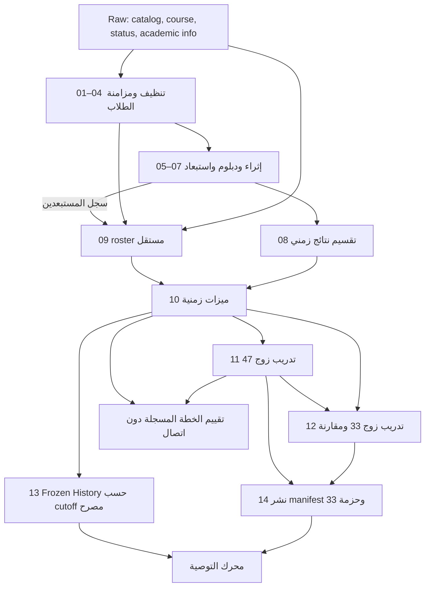
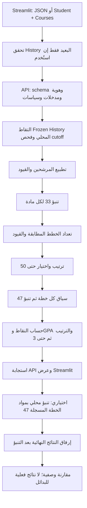

# خريطة خط البيانات ومنطق التوصية

مراجعة قراءة للكود الموجود في Stable بتاريخ 2026-11-07. تصف الخريطة ما ينفذه الكود، وليست اعتمادًا أكاديميًا أو إثباتًا لصحة بيانات الجامعة. لم تُشغّل إعادة بناء أو تدريب أو اختبارات أثناء هذه المراجعة. المسارات أدناه نسبية إلى جذر المشروع، وروابط الملفات نسبية إلى هذا المستند. [مسارات البيانات المركزية](../src/paths.py) هي مرجع أسماء الملفات؛ مخرجات كل مرحلة أدناه هي التي يكتبها كودها، وليست وعدًا بأن كل ملف موجود أو حديث.

**مستوى الدليل:** `VERIFIED` يعني تحقق السلوك المحدد بقراءة مسار التنفيذ الحالي، لا نجاح تشغيل جديد أو صحة القرار الجامعي؛ `PARTIAL` يعني وجود حماية أو أدلة لجزء من المطلوب مع بقاء فجوة؛ `UNVERIFIED` يعني أن الدليل المتاح لا يحسم الادعاء؛ `KNOWN_LIMITATION` يعني قيدًا أو مخاطرة محددة ظاهرة في الكود. الاختبار المذكور دليل على حالة يهدف إلى فحصها فقط، وليس دليل نجاح حالي.

سجل التشغيل المحفوظ [Phase 01 XML](migration/phase01_tests.xml) و[النص](migration/phase01_tests.txt) يوثقان **219 passed** في 2026-11-03 لمرحلة التنظيف حينها. يسجل [CHANGELOG](CHANGELOG.md) بتاريخ 2026-11-05 نجاح 951 اختبارًا وتجاوز اختبار واحد وتحذيرًا في Stable، و951 في نسخة مستقلة؛ هذه **خلاصة تاريخية مكتوبة** لا سجل تفصيلي حالي لكل الاختبارات، ولا تثبت تطابق الملفات الحالية مع الملفات المفحوصة. يسجل أيضًا اختبارات مركزة وتقييمًا وصفيًا للخطة الفعلية؛ يلزم إعادة تأكيدها قبل الاستناد إليها كدليل حالي. لم يتم اختبار اتصال الجامعة الحقيقي أو الفحص البصري المباشر بحسب السجل.

## 1. خريطة البناء والتدريب

ينظم [src/main.py](../src/main.py) الخطوات القياسية، لكن الرسم يستند إلى قراءات وكتابات الوحدات نفسها. الأرقام ترتيب قراءة واعتماد، لا تعني أن الفرعين مستقلين زمنيًا عن متطلباتهما أو أن `--all` ينشر حزمة serving.

| رقم | الملف والدالة الأساسية | المدخلات ← المخرجات | الوظيفة والمستهلك التالي | الاختبار المقابل |
|---|---|---|---|---|
| 01 | [src/data/cleaning/clean_degree_course.py](../src/data/cleaning/clean_degree_course.py) `clean_degree_course`, `main` | `data/raw/v_acd_degree_course.parquet` ← `data/clean/degree_course.parquet` | تنظيف كتالوج الدرجة والمواد؛ تستهلكه 05 و09 وكتالوج API. | [test_clean_degree_course.py](../tests/unit/test_clean_degree_course.py) |
| 02 | [src/data/cleaning/clean_student_course.py](../src/data/cleaning/clean_student_course.py) `clean_student_course`, `main` | `data/raw/v_crg_student_course_raw.parquet` ← `data/clean/student_course_pre_common.parquet` | تنظيف تسجيلات المادة وترقيم المحاولات قبل بعض فلاتر النتيجة؛ إلى 04. | [test_clean_student_course.py](../tests/unit/test_clean_student_course.py) |
| 03 | [src/data/cleaning/clean_student_status.py](../src/data/cleaning/clean_student_status.py) `clean_student_status`, `main` | `data/raw/v_add_student_degree_status.parquet` ← `data/clean/student_status_pre_common.parquet` | تنظيف حالة الطالب والدرجة والميزات التاريخية؛ إلى 04. | [test_clean_student_status.py](../tests/unit/test_clean_student_status.py) |
| 04 | [src/data/building/filter_common_students.py](../src/data/building/filter_common_students.py) `filter_common_students`, `main` | ملفا `student_course_pre_common.parquet` و`student_status_pre_common.parquet` ← `data/clean/student_course.parquet` و`data/clean/student_status.parquet` | إبقاء الطلاب المشتركين؛ إلى 05، والحالة إلى 09 و10. | [test_filter_common_students.py](../tests/unit/test_filter_common_students.py) |
| 05 | [src/data/building/build_student_course_enriched.py](../src/data/building/build_student_course_enriched.py) `main` | `data/clean/student_course.parquet`، `data/clean/student_status.parquet` و`data/clean/degree_course.parquet` ← `data/clean/student_course_enriched.parquet` | وصل سجلات المادة بمعلومات الحالة والكتالوج؛ إلى 06. | [test_build_student_course_enriched.py](../tests/unit/test_build_student_course_enriched.py) |
| 06 | [src/data/cleaning/clean_student_diploma.py](../src/data/cleaning/clean_student_diploma.py) `clean_student_diploma`, `merge_student_course_with_diploma`, `main` | `data/raw/v_add_academic_info.parquet` و`data/clean/student_course_enriched.parquet` ← `data/clean/student_diploma.parquet` و`data/merged/student_course_enriched_with_diploma.parquet` | تنظيف الدبلوم ووصله يساريًا دون تغيير عدد صفوف المادة؛ الملف المدمج إلى 07. | [test_clean_student_diploma.py](../tests/unit/test_clean_student_diploma.py) |
| 07 | [src/data/cleaning/clean_outliers.py](../src/data/cleaning/clean_outliers.py) `build_outlier_audit`, `remove_outlier_students`, `main` | الملف المدمج في 06 ← `data/merged/student_course_enriched_without_outliers.parquet` و`data/merged/outlier_students.parquet` | تطبيق القواعد الحالية على مستوى الطالب؛ الأول إلى 08 وسجل الاستبعاد إلى 09. | [test_clean_outliers.py](../tests/unit/test_clean_outliers.py) |
| 08 | [src/data/building/build_temporal_split.py](../src/data/building/build_temporal_split.py) `build_temporal_split`, `main` | ملف without_outliers ← `data/temporal/temporal_train.parquet` و`data/temporal/temporal_test.parquet` | تقسيم النتائج: تدريب 20201–20243؛ اختبار 20251 و20252؛ استبعاد 20253 غير المكتمل؛ إلى 10. | [test_build_temporal_split.py](../tests/unit/test_build_temporal_split.py) |
| 09 | [src/data/building/build_registration_roster.py](../src/data/building/build_registration_roster.py) `build_registration_roster`, `main` | `data/raw/v_crg_student_course_raw.parquet`، `data/clean/student_status.parquet`، `data/clean/degree_course.parquet` و`data/merged/outlier_students.parquet` ← `data/clean/registration_roster.parquet` و`data/temporal/temporal_train_roster.parquet` و`data/temporal/temporal_test_roster.parquet` | فرع التسجيل الفصلي لسياق الخطة، وليس نسخة من صفوف النتائج في 08؛ إلى 10. | [test_build_registration_roster.py](../tests/unit/test_build_registration_roster.py) |
| 10 | [src/features/build_temporal_features.py](../src/features/build_temporal_features.py) `build_feature_tables`, `main`؛ [temporal_features.py](../src/features/temporal_features.py) `build_temporal_course_history`, `add_student_history_features`, `compute_plan_context_features` | `data/temporal/temporal_train.parquet`، `data/temporal/temporal_test.parquet`، `data/temporal/temporal_train_roster.parquet`، `data/temporal/temporal_test_roster.parquet` و`data/clean/student_status.parquet` ← `data/features/temporal_train_features.parquet`، `data/features/temporal_test_features.parquet` و`data/artifacts/course_history_state.pkl` | يطبق تاريخ المادة قبل تحديثه بنتائج الفصل، ويبني ميزات الطالب وسياق التسجيل؛ الميزات إلى 11–13. | [test_temporal_features.py](../tests/unit/test_temporal_features.py)، [test_feature_contract_responsibilities.py](../tests/unit/test_feature_contract_responsibilities.py) |
| 11 | [src/modeling/train_models.py](../src/modeling/train_models.py) `main` | ملفا ميزات train/test ← `models/grade_regressor.txt`، `models/fail_risk_classifier.txt`، `models/model_metadata.json` و`data/artifacts/category_levels.json` | تدريب زوج 47 ميزة للعلامة والرسوب؛ إلى 12 و14 وإلى Stage 2 بعد النشر. | [test_train_models.py](../tests/unit/test_train_models.py)، [test_training_config.py](../tests/unit/test_training_config.py) |
| 12 | [src/modeling/train_shortlist_models.py](../src/modeling/train_shortlist_models.py) `train_experiment`، يستدعيها مدخل الوحدة مباشرة | `data/features/temporal_train_features.parquet` و`data/features/temporal_test_features.parquet`، أصول 11 وmetadata والفئات ← `models/shortlist_training/` وفيه نموذجا `grade_regressor.txt`, `fail_risk_classifier.txt` و`category_levels.json`, `model_metadata.json`؛ و`data/evaluation/shortlist/grade_validation.json`, `fail_validation.json`, `holdout_predictions.parquet`, `model_comparison.json` | تدريب زوج 33 ميزة ومقارنته؛ مخرجات التدريب مصدر نشر 14 وليست نفسها حزمة serving. مدرج ضمن الخطوات القياسية رغم تسمية experiment. | [test_two_stage_artifacts.py](../tests/unit/test_two_stage_artifacts.py)، [test_two_stage_matrix.py](../tests/unit/test_two_stage_matrix.py) |
| 13 | فرع مستقل [src/features/build_frozen_history.py](../src/features/build_frozen_history.py) `main` و[frozen_history.py](../src/features/frozen_history.py) `build_frozen_history`, `save_frozen_history` | ميزات تدريب 10 افتراضيًا، مع ميزات الاختبار إن كان cutoff بعد 20243، وتصريح `as-of-part` و`finalized-through-part` ← `data/artifacts/history/as_of_<part>/course_history_state.pkl` و`metadata.json`؛ ملف specialty اختياري | حزمة نتائج نهائية حتى cutoff شامل، تتحقق من المصدر والبصمة ولا تستبدل نسخة قائمة؛ يستهلكها مدير التاريخ للتوصية. ليست ضمن `--all`. | [test_frozen_history.py](../tests/unit/test_frozen_history.py) |
| 14 | نشر منفصل [src/modeling/build_artifact_manifest.py](../src/modeling/build_artifact_manifest.py) `build_promotion_manifest`, `promote_shortlist_artifacts` | نماذج وmetadata 11 و12، أدلة المقارنة، سلم `data/raw/v_acs_grade.parquet` ومرجع الاعتماد عند تفعيل سياسة الترتيب ← `models/shortlist/grade_model.txt`, `fail_model.txt`, `category_levels.json`, `manifest.json` | يتحقق في staging وينشر حزمة 33 دون استبدال، ويربط manifest بزوج 47 والبصمات والعقود؛ إلى [two_stage_artifacts.py](../src/recommendation/two_stage_artifacts.py). ليس ضمن `--all`؛ وجود النماذج المدربة وحده لا يعني جاهزية serving. | [test_fresh_artifact_metadata.py](../tests/unit/test_fresh_artifact_metadata.py)، [test_two_stage_artifacts.py](../tests/unit/test_two_stage_artifacts.py)، [test_two_stage_activation.py](../tests/unit/test_two_stage_activation.py) |
| 15 | تقييم منفصل [src/evaluation/evaluate_plan_gpa.py](../src/evaluation/evaluate_plan_gpa.py) `main`, `predict_course_points`, `aggregate_plan_gpa` | `data/features/temporal_test_features.parquet`، `models/grade_regressor.txt`، `models/model_metadata.json`، `data/artifacts/category_levels.json` و`data/raw/v_acs_grade.parquet` ← `data/evaluation/plan_gpa_course_predictions_2025.parquet`، `data/evaluation/plan_gpa_evaluation_2025.parquet`، `data/evaluation/plan_gpa_metrics_2025.json` | تقييم وصفي للخطط المسجلة؛ ليس مدخلًا للتوصية أو دليلًا على نتائج البدائل. يُدرج بعد 12 في `--all` دون انتظار 13 أو 14. | [test_evaluate_plan_gpa.py](../tests/unit/test_evaluate_plan_gpa.py) |

التقييم في 15 غير متصل ومستقل عن التقييم التفاعلي أدناه؛ لم يشغّل هنا. في [src/main.py](../src/main.py) يصف عرض القائمة كل خطوة بأنها `main()`، لكن مدخل 12 يستدعي `train_experiment()` مباشرة، ومدخل 14 يستدعي `promote_shortlist_artifacts()` مباشرة.

## 2. خريطة طلب التوصية والتقييم

| رقم | الملف والدالة | التنفيذ الفعلي |
|---|---|---|
| 01 | [tools/academic_advisor_streamlit/streamlit_app.py](../tools/academic_advisor_streamlit/streamlit_app.py) `main`؛ [ui_client.py](../tools/academic_advisor_streamlit/ui_client.py)؛ [views.py](../tools/academic_advisor_streamlit/views.py) `combine_request` | إما طلب JSON محلي كامل، أو إدخال الطالب والدرجة والفصل والساعات ثم جلب Student وCourses وHistory من الجامعة وتكوين الطلب بالسياق. رد History البعيد يُفحص بـ`verify_remote_history` فقط؛ لا يُستورد أو يُفعّل للتنبؤ. يحدد الطلب cutoff، والواجهة تفرض `top_k=3`. |
| 02 | [src/api/app.py](../src/api/app.py) `create_app` ومسار `POST /api/v1/recommendations`؛ [schemas.py](../src/api/schemas.py) `RecommendationRequest`؛ [service.py](../src/api/service.py) `ApiService.recommend` | يستقبل API الطلب ويتحقق من schema، ثم الطالب والمواد عبر `validate_student`, `validate_courses` والمحوّلات و[validators](../src/api/validators/courses.py). يرفض الأخطاء ونقص مصادر أو حقول لازمة بدل اختراعها. |
| 03 | [src/api/service.py](../src/api/service.py) `_prepare_recommendation_context`؛ [src/features/frozen_history.py](../src/features/frozen_history.py) `validate_history_selection`؛ [history_update.py](../src/recommendation/history_update.py) `FrozenHistoryManager.capture` | يتحقق من الجاهزية وسبق cutoff التدريب للهدف، ويلتقط نسخة التاريخ المحلية المطلوبة. النمط العادي يشترط الفصل الأكاديمي السابق مباشرة؛ التاريخ الأقدم مسموح فقط في backtesting المفعّل. لا تكفي مطابقة رقم الفصل لإثبات صحة المصدر النهائي خارجيًا. |
| 04 | [src/api/service.py](../src/api/service.py) `_build_engine_request`؛ [adapters/courses.py](../src/api/adapters/courses.py) | يلتقي مجال الساعات المطلوب مع المجال المؤكد ويعد سياسات المجموعات والإعادات. عند إعطاء مجال يأخذ **الحد الأعلى المتقاطع هدفًا مطابقًا**، لا يجرب كل إجمالي داخل المجال. حدود نوع المتطلب في هذا المسار تُبنى من مجموع ساعات المرشحين؛ حدود مجموعات المتطلبات تستند إلى السياسة المكيّفة. |
| 05 | [src/recommendation/inputs.py](../src/recommendation/inputs.py) `prepare_recommendation_payloads`؛ [two_stage_engine.py](../src/recommendation/two_stage_engine.py) `_prepare_candidates` | تطبيع لقطة الطالب والمرشحين والقيود، وإضافة ميزات التاريخ المجمد للمواد. الأهلية تعتمد على أعلام ومصدر الجامعة المعتمدين؛ لا يحسب المحرك كل المتطلبات السابقة من أولها. |
| 06 | [src/recommendation/two_stage_engine.py](../src/recommendation/two_stage_engine.py) `recommend_from_payloads`؛ [plan_scoring.py](../src/recommendation/plan_scoring.py) `score_course_rows` | زوج المرحلة الأولى يتنبأ بالعلامة واحتمال الرسوب **لكل مادة مرشحة أولًا** باستخدام عقد 33 ميزة، قبل تعداد الخطط. |
| 07 | [src/recommendation/shortlist.py](../src/recommendation/shortlist.py) `build_stage1_shortlist`؛ [constraints.py](../src/recommendation/constraints.py) `enumerate_feasible_plan_indices`؛ [plan_generation.py](../src/recommendation/plan_generation.py) `enumerate_plan_indices` | تعداد مجموعات الساعات المطابقة بالضبط، وتطبيق حدود المتطلبات والإعادة والمواد الجديدة، وتجميع تقديرات 33 وترتيب الخطط المقبولة بسياسة المرحلة الأولى؛ الاحتفاظ بحد أقصى 50. |
| 08 | [src/recommendation/two_stage_engine.py](../src/recommendation/two_stage_engine.py) `_score_stage2`, `recommend_from_payloads`؛ [temporal_features.py](../src/features/temporal_features.py) `compute_plan_context_features` | تكوين صفوف المواد لكل خطة مختصرة وحساب سياق كل خطة ثم تشغيل زوج 47 ميزة من جديد؛ تنبؤات المرحلة الأولى لا تدخل التقييم النهائي. |
| 09 | [plan_scoring.py](../src/recommendation/plan_scoring.py) `score_course_rows`, `summarize_scored_plans`, `project_cumulative_gpa`؛ [src/grade_scale.py](../src/grade_scale.py) `GradeScale.convert`؛ [ranking.py](../src/recommendation/ranking.py) `rank_evaluation_plans` | تقص العلامة إلى 0–100 وتحوّل إلى نقاط بحسب نسخة السلم، ويحسب متوسط الخطة والتراكمي الإضافي والرسوب المتوقع؛ تطبق استراتيجية manifest وBalance/Pareto بحسب النطاق ثم يؤخذ `top_k`. النتيجة داخل shortlist فقط. |
| 10 | [src/api/service.py](../src/api/service.py) `_recommendation_response`؛ [src/api/app.py](../src/api/app.py) | يعيد API الحالة والخطط والـmetadata المسموح به؛ قد يعيد `no_feasible_plan` ولا يضمن وجود ثلاث خطط. |
| 11 | [tools/academic_advisor_streamlit/streamlit_app.py](../tools/academic_advisor_streamlit/streamlit_app.py) `main`, `local_engine`؛ [views.py](../tools/academic_advisor_streamlit/views.py) `registered_courses`؛ [src/evaluation/observed_plan.py](../src/evaluation/observed_plan.py) `predict_observed_plan` | بعد استجابة API، وبشكل اختياري، تُقرأ الخطة المسجلة من JSON أو بيانات Stable، ثم يتنبأ محرك محلي بموادها كاملة باستخدام سياق الخطة وزوج 47 والتاريخ المطلوب. لا تمر الخطة الفعلية عبر endpoint التوصية ولا تُرشّح وفق أهلية البدائل. |
| 12 | [src/evaluation/observed_plan.py](../src/evaluation/observed_plan.py) `attach_actual_outcomes`؛ [views.py](../tools/academic_advisor_streamlit/views.py) `local_actual_outcomes`, `comparison_rows`؛ [streamlit_app.py](../tools/academic_advisor_streamlit/streamlit_app.py) `main` | بعد التنبؤ فقط تُرفق نتائج نهائية ذات مصدر وهوية وساعات متطابقة إن توفرت، وتعرض مقارنة الخطة المسجلة مع البدائل. النتائج الفعلية للبدائل تبقى فارغة؛ فشل تقييم الخطة الفعلية يعرض تحذيرًا ولا يحجب الخطط المستلمة. |

حساب متوسط الخطة = مجموع `(ساعات المادة × نقاطها المتوقعة)` ÷ ساعات الخطة. التراكمي المعروض = `(التراكمي السابق × ساعات GPA السابقة + نقاط جودة الخطة)` ÷ `(ساعات GPA السابقة + ساعات الخطة)`. النقاط ناتجة من **العلامة المتنبأ بها بعد تحويلها بسلم الدرجات**؛ احتمال الرسوب مخرج مستقل، ولا يُضرب في هذه النقاط. الإسقاط إضافي ولا يطبق استبدال الإعادة الرسمي؛ عند رصد إعادة توضع إشارة تتطلب مراجعة السياسة.

## 3. جدول الدوال والاعتماديات المؤثرة

| المسؤولية | الدوال والملفات | يعتمد على / يستخدمه |
|---|---|---|
| الحدود الزمنية | [academic_calendar.py](../src/data/academic_calendar.py)، [build_temporal_split.py](../src/data/building/build_temporal_split.py) `build_temporal_split` | معرفات الفصول؛ بناء النتائج والـroster والاختبارات الزمنية. |
| ترتيب الميزات | [feature_contract.py](../src/features/feature_contract.py) `prepare_model_matrix`، [shortlist_features.py](../src/modeling/shortlist_features.py) `prepare_course_matrix`، [two_stage_artifacts.py](../src/recommendation/two_stage_artifacts.py) `stage_feature_contract` | مستويات الفئات وميزات كل مرحلة؛ التدريب والتنبؤ. |
| سلامة الأصول | [two_stage_artifacts.py](../src/recommendation/two_stage_artifacts.py) `load_two_stage_artifacts`؛ [ranking_policy.py](../src/recommendation/ranking_policy.py) `validate_ranking_policy` | manifest والبصمات والفئات وheaders وقيد التدريب وسياسة الترتيب وسلّم الدرجات؛ تهيئة المحرك. |
| شروط الخطة | [inputs.py](../src/recommendation/inputs.py) `prepare_recommendation_payloads`؛ [constraints.py](../src/recommendation/constraints.py) `enumerate_feasible_plan_indices` | مرشحو المصدر وسياسات الساعات؛ اختيار shortlist. |
| الترتيب | [ranking.py](../src/recommendation/ranking.py) `rank_evaluation_plans`؛ [balance_policy.py](../src/recommendation/balance_policy.py) `compute_balance_components` | مقاييس المرحلة وسياسة manifest؛ المرحلتان. |
| التسجيل الفعلي | [observed_plan.py](../src/evaluation/observed_plan.py) `predict_observed_plan`, `attach_actual_outcomes` | لقطة ما قبل الفصل ومواد مسجلة كاملة، ثم نتائج نهائية مستقلة؛ عرض Streamlit. |

## 4. Logic Verification Matrix

في عمود Evidence، «كود» يعني فحص التنفيذ الحالي؛ مراجع الاختبارات تشير إلى حالات مصممة للتحقق ولا تعني أنها نُفذت هنا. الدليل التاريخي العام موضح في المقدمة.

| Logic | File | Function | Expected Behavior | Test | Evidence | Status |
|---|---|---|---|---|---|---|
| Cleaning policies | [clean_student_course.py](../src/data/cleaning/clean_student_course.py)، [clean_student_diploma.py](../src/data/cleaning/clean_student_diploma.py)، [clean_outliers.py](../src/data/cleaning/clean_outliers.py) | `clean_student_course`, `clean_student_diploma`, `remove_outlier_students` | تطبيق الفلاتر وnull المعتمدة دون تغييرها | [course](../tests/unit/test_clean_student_course.py)، [diploma](../tests/unit/test_clean_student_diploma.py)، [outliers](../tests/unit/test_clean_outliers.py) | الكود: تعبئة الدبلوم عامة عبر الصفوف ومصرح باعتمادها في التعليق؛ الاستبعاد يشمل جميع سجلات الطالب. مخاطر السياسة لا يثبتها اجتياز الاختبار. | KNOWN_LIMITATION |
| Degree-scoped student history | [clean_student_status.py](../src/data/cleaning/clean_student_status.py)، [temporal_features.py](../src/features/temporal_features.py) | `clean_student_status`, `compute_student_gpa_history` | عدم انتقال تاريخ درجة إلى أخرى | [status](../tests/unit/test_clean_student_status.py)، [features](../tests/unit/test_temporal_features.py) | تنظيف الحالة بنطاق الطالب والدرجة، لكن fallback لـ`gpa_prev_1` و`gpa_prev_2` يعمل حسب الطالب فقط؛ ترتيب الدرجات بنفس الفصل قد يمرر معلومة من درجة أخرى. | KNOWN_LIMITATION |
| Attempt numbering | [clean_student_course.py](../src/data/cleaning/clean_student_course.py) | `clean_student_course` | ترتيب محاولات الطالب والمادة بعد الفرز الزمني | [test_clean_student_course.py](../tests/unit/test_clean_student_course.py) | الكود يجمع حسب الطالب والمادة لا الدرجة، قبل حذف حالات النهاية وبعض الصفوف؛ المنسحب قد يزيد العد. صلاحية النطاق قرار أكاديمي. | PARTIAL |
| Temporal split | [build_temporal_split.py](../src/data/building/build_temporal_split.py) | `build_temporal_split` | تدريب حتى 20243؛ اختبار 20251–20252 واستبعاد 20253 | [test_build_temporal_split.py](../tests/unit/test_build_temporal_split.py) | حدود ثابتة في الكود؛ لم يُفحص تشغيل البيانات الحالي. | VERIFIED |
| Feature leakage prevention | [temporal_features.py](../src/features/temporal_features.py)، [feature_contract.py](../src/features/feature_contract.py) | `build_temporal_course_history`, `prepare_model_matrix` | تاريخ المادة قبل نتائج الفصل واستبعاد أعمدة التسرب من مصفوفة النموذج | [test_temporal_features.py](../tests/unit/test_temporal_features.py) | ترتيب apply ثم update وفصل حالة اختبار، لكن نطاق GPA أعلاه وصحة كل مدخل زمني من المصدر غير محسومين. | PARTIAL |
| Frozen History cutoff | [frozen_history.py](../src/features/frozen_history.py) | `build_frozen_history`, `validate_history_selection`, `load_frozen_history` | نتائج حتى cutoff مصرح به ومطابقة البصمات؛ يسبق الهدف | [test_frozen_history.py](../tests/unit/test_frozen_history.py) | الكود يفحص القطع والشمول والهاش؛ نهائية المصدر نفسها تصريح خارجي. | PARTIAL |
| Feature order 33/47 | [feature_contract.py](../src/features/feature_contract.py)، [two_stage_artifacts.py](../src/recommendation/two_stage_artifacts.py) | `prepare_model_matrix`, `stage_feature_contract` | ترتيب مطابق لعقد كل مرحلة | [test_two_stage_matrix.py](../tests/unit/test_two_stage_matrix.py)، [test_two_stage_artifacts.py](../tests/unit/test_two_stage_artifacts.py) | الكود يشتق العقد ويرتب الأعمدة؛ توافق الأصول الفعلي يحتاج فحص تحميل حالي. | PARTIAL |
| Model artifact compatibility | [two_stage_artifacts.py](../src/recommendation/two_stage_artifacts.py) | `load_two_stage_artifacts`, `load_manifest_assets` | رفض اختلاف hash والميزات والفئات والنسخ | [test_two_stage_artifacts.py](../tests/unit/test_two_stage_artifacts.py)، [test_two_stage_activation.py](../tests/unit/test_two_stage_activation.py) | فحوص التحميل في الكود؛ سجل 2026-11-05 يقول إن الأصول حُمّلت حينها، ولم يعاد التحميل هنا. | PARTIAL |
| Academic eligibility | [validators/courses.py](../src/api/validators/courses.py) | `validate_course_fields`, `validate_previous_course_status` | قبول الأعلام والأسباب والسياسة المثبتة فقط | [test_api_stable.py](../tests/integration/test_api_stable.py)، [test_two_stage_payloads.py](../tests/unit/test_two_stage_payloads.py) | Y/Y ومصدر الحالة والأسباب تُفحص؛ أهلية المتطلبات والاستثناءات تعتمد على المصدر ولا تُثبت ببيانات اصطناعية. | PARTIAL |
| Credit-hour constraints | [service.py](../src/api/service.py)، [constraints.py](../src/recommendation/constraints.py) | `_build_engine_request`, `enumerate_feasible_plan_indices` | هدف دقيق ضمن حدود التسجيل | [test_two_stage_constraints.py](../tests/unit/test_two_stage_constraints.py) | الكود يختار الحد الأعلى عند طلب مجال؛ لا fallback لمجموع أقل إذا تعذر. | VERIFIED |
| Retake and completed-course constraints | [course_status.py](../src/recommendation/course_status.py)، [constraints.py](../src/recommendation/constraints.py) | `classify_candidate_status`, `enumerate_feasible_plan_indices` | حدود إعادة الراسب والمنسحب والاعتماد على أهلية المصدر | [test_two_stage_constraints.py](../tests/unit/test_two_stage_constraints.py)، [test_two_stage_payloads.py](../tests/unit/test_two_stage_payloads.py) | الساعات تقيد الإعادة؛ `PASSED` يصنف ضمن `OTHER_PREVIOUS` ولا يوجد رفض مستقل شامل له إذا أجازه المصدر. | KNOWN_LIMITATION |
| Requirement-type credit limits | [constraints.py](../src/recommendation/constraints.py)، [service.py](../src/api/service.py) | `normalize_requirement_policies`, `_build_engine_request` | حدود النوع والمجموعة لا تُتجاوز حسب السياسات المقدمة | [test_two_stage_constraints.py](../tests/unit/test_two_stage_constraints.py) | محرك payload يقبل حد نوع صريح؛ API الحالي يضع حد النوع بمجموع ساعات المرشحين، بينما يطبق حدود المجموعة من السياسة المؤكدة. لا يثبت ذلك حدًا جامعيًا مستقلًا لكل نوع. | PARTIAL |
| Stage 1 shortlist | [shortlist.py](../src/recommendation/shortlist.py) | `build_stage1_shortlist` | تقييم الخطط الممكنة ثم اختيار حتى 50 | [test_two_stage_shortlist.py](../tests/unit/test_two_stage_shortlist.py)، [test_two_stage_engine.py](../tests/unit/test_two_stage_engine.py) | الكود يعدد المقبول ويرتب قبل `head(50)`؛ لا ضمان لبقاء الأفضل وفق المرحلة الثانية. | VERIFIED |
| Stage 2 rescoring | [two_stage_engine.py](../src/recommendation/two_stage_engine.py) | `_score_stage2`, `recommend_from_payloads` | سياق خاص بكل خطة وإعادة تنبؤ 47 | [test_two_stage_engine.py](../tests/unit/test_two_stage_engine.py) | لا تُرحل تنبؤات المرحلة الأولى للنتائج النهائية؛ تحقق الكود فقط. | VERIFIED |
| Ranking and Top 3 | [ranking.py](../src/recommendation/ranking.py)، [two_stage_engine.py](../src/recommendation/two_stage_engine.py) | `rank_evaluation_plans`, `recommend_from_payloads` | ترتيب السياسة المفعلة وإرجاع حتى 3 بالواجهة | [test_ranking_strategies.py](../tests/unit/test_ranking_strategies.py)، [test_two_stage_engine.py](../tests/unit/test_two_stage_engine.py) | Top 3 محصورة في shortlist، والترتيب يتأثر بنطاق Balance وPareto؛ لا ضمان عالمي. | KNOWN_LIMITATION |
| Grade-to-points conversion | [grade_scale.py](../src/grade_scale.py)، [plan_scoring.py](../src/recommendation/plan_scoring.py) | `GradeScale.convert`, `score_course_rows` | تحويل العلامة المقصوصة بسلم النسخة المعتمدة | [test_grade_scale.py](../tests/unit/test_grade_scale.py) | الكود يرفض نسخة غير مدعومة ويستخدم شرائح النجاح؛ لم تُعتمد محتويات السلم أكاديميًا في هذه المراجعة. | PARTIAL |
| Term GPA and projected cumulative GPA | [plan_scoring.py](../src/recommendation/plan_scoring.py) | `summarize_scored_plans`, `project_cumulative_gpa` | متوسط مرجح بالساعات وإسقاط إضافي | [test_two_stage_engine.py](../tests/unit/test_two_stage_engine.py)، [test_evaluate_plan_gpa.py](../tests/unit/test_evaluate_plan_gpa.py) | الصيغة لا تستبدل المحاولات السابقة، وتعتمد صحة مقام `current_gpa_credits` من المصدر. | KNOWN_LIMITATION |
| Actual-plan prediction | [observed_plan.py](../src/evaluation/observed_plan.py) | `predict_observed_plan` | تنبؤ وصفي لكامل التسجيل بسياقه قبل إرفاق النتائج | [test_observed_plan.py](../tests/unit/test_observed_plan.py) | الكود يطلب جميع المواد ويلتقط تاريخًا سابقًا؛ توفر بيانات ما قبل الهدف وصحتها خارجيًا غير مثبتين. | PARTIAL |
| Predicted vs actual evaluation | [observed_plan.py](../src/evaluation/observed_plan.py)، [views.py](../tools/academic_advisor_streamlit/views.py) | `attach_actual_outcomes`, `comparison_rows` | فصل النتائج النهائية ومطابقة الهوية والساعات وعدم اختلاق نتائج بدائل | [test_observed_plan.py](../tests/unit/test_observed_plan.py)، [test_stable_ui_views.py](../tests/unit/test_stable_ui_views.py) | حساب الأخطاء للمطابق المتاح فقط؛ تقييم وصفي لا يثبت نتائج الخطط البديلة. | PARTIAL |
| API validation and Streamlit display | [app.py](../src/api/app.py)، [service.py](../src/api/service.py)، [streamlit_app.py](../tools/academic_advisor_streamlit/streamlit_app.py) | `create_app`, `ApiService.recommend`, `main` | رفض المدخل غير المتوافق وعرض النتائج وحدودها | [test_api_stable.py](../tests/integration/test_api_stable.py)، [test_streamlit_stable.py](../tests/integration/test_streamlit_stable.py) | سجل نجاح تاريخي وAppTest اصطناعي؛ لا تحقق حالي من الجامعة أو عرض المتصفح الحقيقي. | PARTIAL |
| University source semantics | [validators/courses.py](../src/api/validators/courses.py)، [student.py](../src/api/validators/student.py) | `validate_course_fields`, `validate_previous_course_status` | أهلية ولقطات الطالب النهائية موثوقة ومتاحة قبل الفصل | [test_api_stable.py](../tests/integration/test_api_stable.py) | حالات اصطناعية وعقود تحقق داخلية فقط؛ لم تتوفر أدلة تكامل حديثة مع المصدر الجامعي. | UNVERIFIED |

## 5. دليل المراجعة اليدوية

الأوامر أمثلة للتشغيل اللاحق من جذر المشروع بعد تجهيز البيئة؛ لم تُنفذ هنا. يمكن تمرير عدة ملفات اختبار إلى `python -m pytest` معًا.

| الترتيب والملف | الهدف والدوال المهمة | المدخلات ← المخرجات والقرار الذي يجب مراجعته | اختبار مقترح |
|---|---|---|---|
| 01 [src/paths.py](../src/paths.py) و[src/main.py](../src/main.py) | `academic_part`, `main`, `_select_steps`: تحديد المسارات وترتيب التشغيل. | ثوابت المسارات ← ملفات المراحل؛ راجع الفرق بين القياسي والتاريخ والنشر الاختياريين. | `python -m pytest tests/unit/test_main_runner.py` |
| 02 [clean_student_course.py](../src/data/cleaning/clean_student_course.py) | `clean_student_course`, `main`: تصفية المادة وترقيم المحاولات. | تسجيلات خام ← pre-common؛ هل يشمل العد المنسحب ودرجات الطالب المختلفة كما تقرر الجامعة؟ | `python -m pytest tests/unit/test_clean_student_course.py` |
| 03 [clean_student_status.py](../src/data/cleaning/clean_student_status.py) | `clean_student_status`, `main`: تاريخ الحالة لكل درجة. | حالة خام ← pre-common؛ راجع ترتيب الفصل والدرجة وحدود بيانات بداية الفصل. | `python -m pytest tests/unit/test_clean_student_status.py` |
| 04 [clean_student_diploma.py](../src/data/cleaning/clean_student_diploma.py) و[clean_outliers.py](../src/data/cleaning/clean_outliers.py) | `clean_student_diploma`, `merge_student_course_with_diploma`, `build_outlier_audit`: إثراء وتنقية. | معلومات الدبلوم والصفوف المثرية ← ملف مدمج ومستبعدون؛ راجع أثر التعبئة العامة واستبعاد تاريخ الطالب كله. | `python -m pytest tests/unit/test_clean_student_diploma.py tests/unit/test_clean_outliers.py` |
| 05 [build_temporal_split.py](../src/data/building/build_temporal_split.py) و[build_registration_roster.py](../src/data/building/build_registration_roster.py) | `build_temporal_split`, `build_registration_roster`: فصل النتائج وبناء roster. | سجلات نظيفة/خام ← مجموعات زمنية منفصلة؛ تحقق من الفصل غير المكتمل وسياق جميع المواد المسجلة. | `python -m pytest tests/unit/test_build_temporal_split.py tests/unit/test_build_registration_roster.py` |
| 06 [temporal_features.py](../src/features/temporal_features.py) و[build_temporal_features.py](../src/features/build_temporal_features.py) | `build_temporal_course_history`, `compute_student_gpa_history`, `compute_plan_context_features`: تاريخ وميزات الخطة. | نتائج وroster وحالة ← ميزات 33/47؛ تحقق من ترتيب تطبيق التاريخ ونطاق GPA بين الدرجات. | `python -m pytest tests/unit/test_temporal_features.py` |
| 07 [frozen_history.py](../src/features/frozen_history.py) و[history_update.py](../src/recommendation/history_update.py) | `build_frozen_history`, `validate_history_selection`, `FrozenHistoryManager.capture`: إصدار التاريخ والتقاطه. | نتائج نهائية وcutoff ← حزمة مصدقة؛ هل المصدر نهائي فعلًا ويسبق الهدف؟ | `python -m pytest tests/unit/test_frozen_history.py tests/unit/test_history_update.py` |
| 08 [feature_contract.py](../src/features/feature_contract.py)، [train_models.py](../src/modeling/train_models.py)، [train_shortlist_models.py](../src/modeling/train_shortlist_models.py) | `prepare_model_matrix`, `main`, `train_experiment`: عقود الميزات والتدريب. | ميزات زمنية ← نماذج وفئات وmetadata؛ راجع ترتيب 33/47 والأهداف والتواريخ لا دقة النموذج وحدها. | `python -m pytest tests/unit/test_train_models.py tests/unit/test_two_stage_matrix.py` |
| 09 [two_stage_artifacts.py](../src/recommendation/two_stage_artifacts.py) و[ranking_policy.py](../src/recommendation/ranking_policy.py) | `load_two_stage_artifacts`, `load_manifest_assets`, `validate_ranking_policy`: تحقق الأصول والسياسة. | manifest ونماذج وسلم ← محرك قابل للتحميل؛ راجع البصمات ومرجع اعتماد السياسة وحدود التشغيل غير المحسومة. | `python -m pytest tests/unit/test_two_stage_artifacts.py tests/unit/test_two_stage_activation.py` |
| 10 [validators/courses.py](../src/api/validators/courses.py) و[service.py](../src/api/service.py) | `validate_course_fields`, `validate_previous_course_status`, `ApiService.recommend`: مصدر أهلية الطالب والمواد. | Student/Courses والسياق ← مرشحون وطلب محرك؛ راجع أعلام الأهلية وسياسات المجموعة والحد الأعلى للساعات. | `python -m pytest tests/integration/test_api_stable.py` |
| 11 [constraints.py](../src/recommendation/constraints.py)، [shortlist.py](../src/recommendation/shortlist.py) | `normalize_requirement_policies`, `enumerate_feasible_plan_indices`, `build_stage1_shortlist`: قبول الخطط والاختصار. | مرشحون مصنفون وسياسات ← خطط مطابقة وأفضل 50؛ راجع حدود النوع والإعادة والمواد المجتازة. | `python -m pytest tests/unit/test_two_stage_constraints.py tests/unit/test_two_stage_shortlist.py` |
| 12 [two_stage_engine.py](../src/recommendation/two_stage_engine.py)، [ranking.py](../src/recommendation/ranking.py) | `_prepare_candidates`, `_score_stage2`, `recommend_from_payloads`, `rank_evaluation_plans`: تنبؤ وترتيب. | مرشحون وتاريخ ونماذج ← خطط؛ راجع ترتيب المرحلتين ونطاق Top 3 وتأثير Balance/Pareto. | `python -m pytest tests/unit/test_two_stage_engine.py tests/unit/test_ranking_strategies.py` |
| 13 [plan_scoring.py](../src/recommendation/plan_scoring.py) و[grade_scale.py](../src/grade_scale.py) | `score_course_rows`, `summarize_scored_plans`, `GradeScale.convert`: علامات ونقاط ومعدلات. | تنبؤات وساعات وسلّم ← GPA واحتمال رسوب؛ راجع مقام التراكمي وسياسة الإعادة. | `python -m pytest tests/unit/test_grade_scale.py tests/unit/test_two_stage_engine.py` |
| 14 [observed_plan.py](../src/evaluation/observed_plan.py)، [views.py](../tools/academic_advisor_streamlit/views.py)، [streamlit_app.py](../tools/academic_advisor_streamlit/streamlit_app.py) | `predict_observed_plan`, `attach_actual_outcomes`, `comparison_rows`, `main`: تقييم وعرض. | تسجيل فعلي ثم نتائج نهائية ← تنبؤ وصفي ومقارنة؛ تحقق من استقلال النتائج وعدم نسب نتائج للبدائل. | `python -m pytest tests/unit/test_observed_plan.py tests/unit/test_stable_ui_views.py tests/integration/test_streamlit_stable.py` |

## 6. أمور غير مثبتة ومخاطر متبقية

1. فصل تاريخ GPA بين الدرجات غير مضمون في `compute_student_gpa_history` رغم عزل تنظيف حالة الطالب؛ يحتاج مراجعة أكاديمية وتقنية قبل أي تصحيح. بعض الصفوف في الفصل نفسه قد تتأثر بترتيب الحالة. لا يعني هذا أن كل ميزات GPA تعبر الدرجات.
2. التعبئة العامة لـ`diploma_gpa` تنقل قيمة من صف سابق قد يخص طالبًا آخر؛ هذا السلوك مصرح باعتماده في تعليق الكود واختباره يثبته. لم يُقدّر حجم أثره الحالي، ولم تتغير السياسة. فلاتر outliers قد تستبعد كامل تاريخ الطالب بسبب سجل واحد.
3. ترقيم المحاولات عبر الدرجات واحتساب السجلات التي تُحذف لاحقًا يتطلبان تأكيدًا أكاديميًا؛ بيانات API للمحاولة السابقة معتمدة على المصدر، وليست إعادة حساب مستقلة من تاريخ كامل.
4. التحقق من مصدر الأهلية أو نهائية التاريخ أو دلالة لقطة ما قبل الفصل يتطلب عقدًا وبيانات موثقة من الجامعة. لا يثبت الكود وحده صلاحية المرشحين أو المقررات المجتازة، ولا صحة المقام التراكمي أو السلم.
5. الخطط الناتجة تخضع لهدف ساعات دقيق وسياسة مجموعات محددة، ثم قائمة مختصرة؛ لا يوجد ضمان لأفضل ثلاث عالميًا ولا لوجود خطة إذا كان الحد الأعلى غير قابل للتحقيق حتى إن وُجد مجموع أقل في المجال. سقف المرشحين وزمن الاستجابة والذاكرة عقود تشغيلية غير محسومة في سياسة الترتيب.
6. التنبؤ بالخطة المسجلة وصفي، والنتائج الفعلية للبدائل غير مرصودة. الإسقاط التراكمي الإضافي ليس معدلًا رسميًا عند الإعادة. أداء التقييم التاريخي لا يثبت صلاحية التوصية أو نتائج بديلة.
7. الأدلة المحفوظة تاريخية والنسخة الحالية غير مثبت نجاح اختباراتها بهذه المراجعة؛ يلزم اختبار موجّه وحديث، وفحص توافق الأصول الفعلية ثم تكامل الجامعة والعرض المرئي قبل التسليم حسب نطاق الاعتماد المطلوب.
