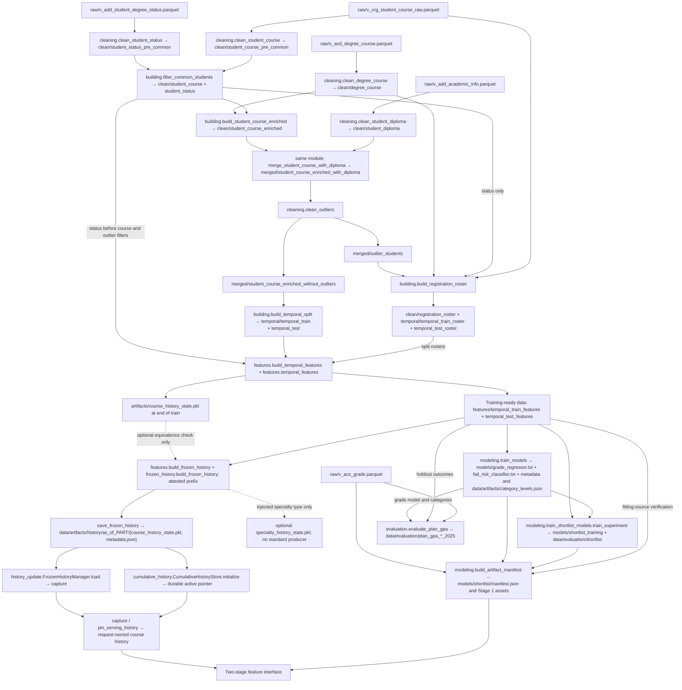

# Phase 8A · Complete data pipeline audit

**Decision — BLOCKED for pipeline sign-off and progression to the recommendation engine audit.** Reviewed 2026-11-19, branch `data_cleaning`, commit `2eb30c7bbb765c9cb8c0a5e75c87ff4d5054fac4` (`P5+P6`). The three Phase 8A reports record an investigation. Academic policy decisions and implementation changes require separate review.

## Executive summary

1. **Later outlier triggers change earlier training and frozen-history inputs.** At the 20243 boundary, 4,168 earlier outcomes from 109 students disappear solely because their first trigger occurs after 20243. Holding all other filters fixed, this changes the weighted global historical mark from 71.1400 to 71.3020 and failure rate from 8.4111% to 8.1742%. The course-history update algorithm respects its term boundary. Its source population already depends on the future.
2. **GPA history changes scope between stages.** Cleaning shifts within student and degree. The feature builder falls back to a student-only shift and computes the second lag across degrees. Degree isolation changes the first lag on 2,470 expected training rows and the second lag on 4,509 training and nine holdout rows. The API validates history against a single degree. No concurrent degree-term rows were found in the common status population.
3. **The classifier predicts a mark below 50.** There are 489 retained training and 42 holdout outcomes coded `F` or `FE` with marks of at least 50. Their model label is zero. This is a measured difference in target meaning. Which label should drive academic advice is a policy decision.
4. **An observed plan in batch evaluation can be incomplete.** Of 12,715 holdout student-degree-terms with supervised outcomes, 2,692 have additional roster courses. Another 526 roster plans have no supervised outcome. The batch GPA evaluator aggregates only courses with retained outcomes. The raw export also lacks a registration-time snapshot for proving which roster rows and catalog attributes were knowable at prediction time.
5. **Code contracts agree on the ordered 31 and 43 inputs.** The six raw exports are present. Cleaned tables, splits, features, model files, manifest, and both published and incremental frozen histories are absent from the canonical locations. Ordered contract checks and synthetic tests establish implementation behavior. No currently deployed binary, persisted history, production run, or model metric was verified.

Use the [pipeline reference](PHASE_8A_PIPELINE_REFERENCE.md) for commands and the [stage checklist](PHASE_8A_REVIEW_CHECKLIST.md) for review decisions.

## Audit boundary and evidence

`src/` owns implementation, `tests/unit/` and `tests/integration/` own tests, `tools/` contains release and UI utilities, `docs/` holds the active documentation and historical reports. `pyproject.toml`, `requirements.lock`, `src/paths.py` and module constants configure the build. `config/` had no files. `data/raw/` was the only populated data directory. Root `artifacts/history/` and `models/active/` contained no files. They are distinct from the canonical build destinations in `src/paths.py`.

The initial `git status --short --branch --untracked-files=all` showed tracking of `origin/data_cleaning`, five modified files (`README.md`, `docs/CHANGELOG.md`, `docs/PIPELINE_AND_LOGIC_MAP.md`, `docs/api_contract.md`, `docs/architecture.md`), and untracked `docs/reports/API_RECOMMENDATION_PHASE_7_REPORT.md`. The working tree was dirty. No tracked implementation or test changes appeared. The documentation inspected was its working-tree version. No fetch or comparison with the live remote was needed.

| Evidence | What was inspected | Limit |
|---|---|---|
| Static source | Runner, cleaners, joins, history, model preparation, publication and feature-consumer boundaries | Establishes implemented transformations |
| Local raw data | All six Parquet schemas, counts, fingerprints, key/term/label checks, and aggregate-only diagnostics on selected columns | University export SQL, revisions, event times and completeness unavailable |
| Conditional row counts | In-memory projections of raw fields using source predicates, key joins, status lags needed by exclusion rules, and `build_outlier_audit` on term groups. First-trigger term measured before union across students. No production stage executed | Expected lineage for these input bytes. Counts are independent of missing output files |
| Unit and interface tests | Synthetic fixtures, disposable temporary paths, mocked training and artifact headers where applicable | Assertions cover the constructed cases |
| Persisted outputs and live validation | No canonical derived Parquets, models, history or active control state available | Cannot measure on-disk feature dtypes/values, predictive accuracy, or upstream request parity |

Row counts below use the supplied extracts. Duplicate counts mean extra rows beyond the first unless stated otherwise. No student values or identifying sample rows are included. The ledger gives aggregate examples of representative record paths.

## Actual execution graph

The standard runner executes serial subprocesses. Separate arrows show **data dependencies** that could be independent. `--all` selects nine data steps, one feature step, two model steps, and one evaluation step. The two publication operations require separate calls.



In the diagram `cleaning` and `building` are under `src.data`. Other module names are under `src`. Dataset stems without an extension are Parquets under `data/`. The additional `v_crg_std_cor_temp_request` extract has no consumer in the standard graph. Specialty injection is an API capability. No call from the CLI supplies an implementation.

## Stage-by-stage ledger

Use the schema ledger below for the exact columns shared across stages. `K` = `(student_id, degree_id, part_id)`, `P` = `(degree_id, course_id)`, `A` = `(student_id, course_id, part_id)`. `student_course_id` identifies a registration instance. No student-only join represents a semester or a degree. `part_id` denotes an academic term rather than a date at which the observation was recorded.

| Stage and purpose | Owning file and function | Inputs, operations and record selection | Output, invariant and observed risk |
|---|---|---|---|
| 0 · Receive university extracts | `src/paths.py`, `main()` of each consuming module, `src/data/cleaning/cleaning_utils.py` | Readers call `pd.read_parquet` against prepositioned local files. No university query, extract timestamp gate, source manifest or central ingestion job found. `clean_column_names` lowercases, strips, replaces whitespace. `clean_id` normalizes textual nulls and integer `.0` suffixes, preserves fractional identifiers. `to_integer`/`to_float` use nullable pandas dtypes and normally raise on unparseable values | Six delivered files described below. The four primary build inputs and grade-scale dependency are distinct. ID precision already lost in a source double could not be recovered by later string conversion |
| 1 · Prepare degree curriculum | `src/data/cleaning/clean_degree_course.py::clean_degree_course` | Catalog only. Cast four IDs to strings, year/semester/requirement type to nullable integer, credits and credits count to nullable float, strip names and active, stable sort by degree/year/semester/course. No active filter or deduplication | `clean/degree_course.parquet`, one row per P. 4,006 rows, 58 degrees, 1,503 courses, all active, unique P and degree-course ID. No effective term for historical plan attributes |
| 2 · Identify outcome-bearing course attempts | `src/data/cleaning/clean_student_course.py::clean_student_course` | Normalize register/finish status, retain R/E. Coerce malformed part to NA, normalize IDs, drop absent course/part. Require registration/student/course/degree/part, reject repeated registration ID or A before the term filter. After `part_id > 20193`, cast marks to Int64, credits/points to Float64, trim names/flags, sort by student/course/term. Within student/course across degrees assign `cumcount()+1` **before** finish and inclusion filters. Keep P → pass, F/FE/FA → fail. Exclude any explicit N in the three GPA/credit flags. Missing flags can pass | `clean/student_course_pre_common.parquet`, one eligible outcome per registration ID and A. 459,620 rows. W, incomplete and other registrations can raise the next attempt number. Pre-window registrations cannot. No final-mark completeness guard here |
| 3 · Build student-degree-term histories | `src/data/cleaning/clean_student_status.py::clean_student_status`, `add_enrollment_features`, `filter_status_rows_after_enrollment`; `src/data/academic_calendar.py` | Cast IDs, counts, GPA/credits and labels. Keep part > 20193, remove semester 4 before building history. Current calendar recognizes regular semesters 1/2 and optional 3. Stable sort by student/degree/part/status ID. Positive semester registrations define enrollment. Prior registered GPA is forward-filled and shifted within degree. First 20201 degree row with evidence of earlier activity can use `prev_gpa_points`. Gap counts intervening regular terms and includes a regular, currently unregistered term. Then remove permanent IDs 1/4/11/12/15/16/41, WITHDRAWN, non-C and missing degree. Missing finish status survives | `clean/student_status_pre_common.parquet`, 108,974 rows, one status ID and K per row in this extract. Earlier later-excluded statuses can supply the lag. No source-level uniqueness enforcement before shifting |
| 4 · Match population membership | `src/data/building/filter_common_students.py::filter_common_students`, `main` | Intersect distinct non-null student IDs from the two pre-common tables across all terms. Apply `isin` independently, preserve every row for shared IDs, assert equal surviving student sets | `clean/student_course.parquet` and `clean/student_status.parquet`, original schemas and grains. 456,595 outcomes and 107,939 statuses, 12,792 students in each. Equal student sets leave term/degree alignment open |
| 5 · Attach term status and catalog to each outcome | `src/data/building/build_student_course_enriched.py::main` | Inner course→status on K with `many_to_one`, then left→plan on P with `many_to_one`. Rename plan payload with `plan_`, suffix colliding course/status fields, convert merge indicator to boolean `plan_match` | `clean/student_course_enriched.parquet`, 456,453 course rows. The inner join drops 142 rows, the left join retains 67 plan misses. Printed “Status match rate: 100.00%” is unconditional and uses no input denominator |
| 6 · Attach pre-university qualifications | `src/data/cleaning/clean_student_diploma.py::clean_student_diploma`, `merge_student_course_with_diploma`, `main` | Project student ID, diploma GPA/type. Drop missing type, keep four most frequent types across the entire academic-info file, map others to `55.111`, globally forward-fill GPA **in file order**, require unique non-null student. Left join by student with `many_to_one`, reject existing diploma fields, assert equal row count | `clean/student_diploma.parquet` (32,524 unique students) and `merged/student_course_enriched_with_diploma.parquet` (456,453 rows). 25 unmatched outcome rows. Global fill and category population differ from online sourcing |
| 7 · Exclude outlier students and retain rule evidence | `src/data/cleaning/clean_outliers.py::build_outlier_audit`, `_summarize_rule`, `remove_outlier_students` | Inspect a single copy per status ID for GPA, nonnegative, upper and logical limits. Inspect every outcome for mark, points, attempt and course credits. Null predicates become false. Group each failed rule by student, recording count and observed range. Union student IDs and exclude **every** outcome for them across terms/degrees. No split boundary participates | `merged/outlier_students.parquet` (1,031 student/scope/rule rows, 759 students) and `merged/student_course_enriched_without_outliers.parquet` (424,435 outcomes). Removes 32,018 rows. The audit has no trigger term column. Future-conditioned selection confirmed |
| 8 · Partition supervised outcomes | `src/data/building/build_temporal_split.py::build_temporal_split`, `main`, `summarize_split` | Fixed train parts 20201–20243, suffixes 1/2/3, test 20251/20252. Separately count 20253. Other terms outside all lists drop without a separate counter. Stable sort by part/student/course/registration ID. Summary failure derives from `course_outcome_status` | `temporal/temporal_train.parquet` and `temporal/temporal_test.parquet` preserve the merged schema and registration grain. Expected 356,882 / 67,548 rows. Five more rows in 20253, none in additional unlisted parts here |
| 9 · Recover full registered course context | `src/data/building/build_registration_roster.py::build_registration_roster`, `main` | Restart from raw course file, retain R/E and part > 20193, normalize keys/credits/finish. Inner join cleaned status key/ID on K (`m:1`), exclude all audited students, left join projected catalog on P (`m:1`), stable sort by part/student/course/registration ID. No P/F, grade-flag, or non-null mark condition. Use stage 8 term **constants**, without reading its files | `clean/registration_roster.parquet` (474,264) and `temporal/temporal_{train,test}_roster.parquet` (389,062 / 74,827). Registration ID unique in both splits. Every projected outcome has its roster row. Final-export roster membership is assumed available at plan time |
| 10 · Build history and context for training | `src/features/build_temporal_features.py::build_feature_tables`, `attach_plan_context`; `src/features/temporal_features.py::build_temporal_course_history`, `add_student_history_features`, `compute_plan_context_features` | Two outcome splits, both roster splits, common cleaned status. Build and apply term history to outcomes and roster; compute contexts by K on roster, attach by registration ID; merge student lags/totals by status ID. Derive semester and `is_fail`. Production supplies full cleaned status. The optional fallback concatenates the provided outcome splits if status is omitted | `features/temporal_{train,test}_features.parquet`, one row per labeled registration if joins are unique, plus `artifacts/course_history_state.pkl` through train max. Training-ready boundary. The context left join lacks a uniqueness/match assertion. See individual features and cohort effects below |
| 11 · Materialize baseline for a specific cutoff | `src/features/build_frozen_history.py::main`; `src/features/frozen_history.py::build_frozen_history`, `save_frozen_history`, `load_frozen_history` | Select nine fields from canonical feature Parquets, optionally from explicitly supplied sources. Verify source hashes during read. Require explicit cutoff/finalization, restrict to prefix, validate keys/numerics, stable sort and update state by term. Optional specialty adapter described below | `data/artifacts/history/as_of_<part>/course_history_state.pkl` and `metadata.json`. This independent branch has no input edge to model training |
| 12 · Fit and evaluate full feature pair | `src/modeling/train_models.py::main`, `prepare_folds`, `tune_model`, `train_one`; `src/modeling/training_config.py` | Read only part, two targets and ordered 43 features from the feature Parquets. Learn fold-local category levels, tune in chronological folds, refit on all train, score holdout | Baseline grade/fail text models, category levels and metadata. Training metadata hardcodes the initial history cutoff. No fit-time source data digest or fail-fast split/target validation in this entry point |
| 13 · Fit shortlist and compare with baseline | `src/modeling/train_shortlist_models.py::train_experiment`, `prepare_course_folds`, `training_signature`; `src/modeling/shortlist_features.py::prepare_course_matrix` | Same feature tables, baseline model files, levels, metadata and source code. Hash inputs at start, check max(train) < min(test), subset official folds to 31, tune/refit, compare predictions with saved baseline. Refuse existing shortlist training metadata | Candidate models/levels/metadata under `models/shortlist_training/`, validation JSON, holdout predictions and comparison under `data/evaluation/shortlist/`. The runner invokes this as a standard step |
| 14 · Publish model bundle | `src/modeling/build_artifact_manifest.py::verify_training_sources`, `build_promotion_manifest`, `promote_shortlist_artifacts`; `src/recommendation/two_stage_artifacts.py::load_manifest_assets`, `load_model_pair` | Verify signed file set and targets, validate original stage metadata, hash grade scale, stage shortlist copies, verify both pairs' binary headers/category orders and recheck originals, rename new destination. Explicit approval reference enables the approved ranking policy | `models/shortlist/{grade_model.txt,fail_model.txt,category_levels.json,manifest.json}`. Manifest references full-feature assets in place. Publication and approval are separate from training and history activation |
| 15 · Evaluate observed outcomes by plan | `src/evaluation/evaluate_plan_gpa.py::main`, `predict_course_points`, `aggregate_plan_gpa`, `build_metrics_report`; `src/grade_scale.py::GradeScale.convert` | Load test outcome features, grade booster, its levels and pass-band table. Clip mark to [0,100], select version-specific lower mark threshold, compute credit × points, aggregate by K, divide by summed outcome credits and compare with outcome-derived/source semester GPA | `data/evaluation/plan_gpa_course_predictions_2025.parquet` (one outcome), `plan_gpa_evaluation_2025.parquet` (one K), `plan_gpa_metrics_2025.json` (aggregate). Source metadata path is recorded but its file is never opened here. Results describe observed outcome-bearing plans |

### Outlier rule details

Fixed upper limits appear in `STATUS_UPPER_LIMITS` below. The code comments attribute them to a 99.9th percentile. The owning fit population and the date used to establish those constants could not be verified. Five GPA fields (`prev_gpa_points`, `last_enrolled_gpa`, `gpa_points`, `start_agpa_points`, `end_agpa_points`) must lie in [0,4]. Four start/end included-course/credit totals, degree credits, and all capped fields must be nonnegative. Marks must be in [0,100], points in [0,4], attempts in [1,5], and course credits nonnegative. Logical excesses trigger if semester or cumulative passes plus failures exceed registrations (courses or credits), registered semesters exceed total semesters, or end included courses/credits fall below start. Valid zero and high course-credit values can survive.

`observed_gap_semesters` 2, `semester_reg_courses` 10, `semester_reg_credits` 39, `semester_pass_courses` 10, `semester_pass_credits` 27, `semester_fail_courses` 6, `semester_fail_credits` 24, `total_semesters` 38, `total_reg_courses` 176, `total_reg_credits` 573.706, `total_pass_courses` 87, `total_pass_credits` 275.379, `total_fail_courses` 96, `total_fail_credits` 340.5, `reg_total_semesters` 36.

## Dataset dictionary and lineage

All paths below are relative to the repository. The raw fingerprints identify the extracts actually inspected. Their metadata do not establish the historical availability of every value.

| File under `data/raw/` | Raw rows | Fields | SHA-256 |
|---|---:|---:|---|
| `v_acd_degree_course.parquet` | 4,006 | 14 | `13eafd910db4caead2132b17ce4a90d470dbaf691e488f14647e16a20efee848` |
| `v_acs_grade.parquet` | 72 | 11 | `557e1cb7b03b09d690d639c8d61c50e5e537360d0dec0684e6a283047111aad2` |
| `v_add_academic_info.parquet` | 32,548 | 6 | `bbaca16bd24c01602e02d35ee8be1068a33d6fa4ad6f1bb194a5caf7ad7cd3a3` |
| `v_add_student_degree_status.parquet` | 189,158 | 46 | `8395641d4dfcfd4e731ead84a53d38b6593e7f5349abf75156f4a10a7a962371` |
| `v_crg_std_cor_temp_request.parquet` | 556,700 | 19 | `1bd99cbb7abac635cbf9be6be7f2adb9718cfeb39fef0f9eca1f700262e10469` |
| `v_crg_student_course_raw.parquet` | 1,017,491 | 20 | `bb25f5413d67cfb3fe41e24f4efee1b90330e4cbdd41a06dcddf91ea33081bba` |

**Physical inputs.** These are the available column sets. The stage descriptions and projections identify which fields participate. Arrow stores numeric identifiers in these extracts as doubles. Most other numerics are doubles, text is large string, grade thresholds and the two short level labels are int64. The cleaners explicitly normalize these representations.

- `v_acd_degree_course` — `degree_course_id`, `course_id`, `degree_id`, `course_type_id`, `requirement_type_id`, `requirement_type_sl`, `course_name_sl`, `course_official_sl`, `degree_name_sl`, `year_order`, `semester_order`, `course_credits`, `active`, `credits_count`.
- `v_acs_grade` — `grade_id`, `grade_version_id`, `grade_name_sl`, `version_title_sl`, `version_number`, `from_percent`, `to_percent`, `points`, `finish_status`, `grade_show`, `active`.
- `v_add_academic_info` — `student_id`, `diploma_gpa`, `diploma_type_id`, `diploma_state_id`, `diploma_country_sl`, `active`.
- `v_add_student_degree_status` — `student_status_id`, `student_id`, `part_id`, `degree_id`, `start_part_id`, `finish_part_id`, `grade_version_id`, `permanent_status_id`, `permanent_status_sl`, `study_mode`, `prev_gpa_points`, `prev_gpa_percent`, `gpa_percent`, `gpa_points`, `start_agpa_percent`, `start_agpa_points`, `start_total_in_courses`, `start_total_in_credits`, `end_total_in_courses`, `end_total_in_credits`, `end_agpa_percent`, `end_agpa_points`, `semester_reg_courses`, `semester_reg_credits`, `semester_pass_courses`, `semester_pass_credits`, `semester_fail_courses`, `semester_fail_credits`, `semester_in_courses`, `semester_in_credits`, `total_semesters`, `total_reg_courses`, `total_reg_credits`, `total_pass_courses`, `total_pass_credits`, `total_fail_courses`, `total_fail_credits`, `reg_total_semesters`, `finish_status`, `version_title_sl`, `degree_name_sl`, `degree_credits_count`, `start_level_id`, `start_level_name_short`, `end_level_name_short`, `start_level_name_pl`.
- `v_crg_std_cor_temp_request` — `std_cor_temp_request_id`, `student_id`, `part_id`, `course_id`, `course_type_id`, `requirement_type_id`, `allow_register`, `is_requestable`, `gpa_percent`, `gpa_points`, `end_agpa_points`, `credits_till_grad`, `requirement_passed_credits`, `credits_count`, `course_credits`, `year_order`, `semester_order`, `register_status`, `finish_status`.
- `v_crg_student_course_raw` — `student_course_id`, `student_id`, `course_id`, `part_id`, `grade_id`, `final_mark`, `points`, `finish_status`, `course_name_sl`, `register_status`, `in_credits`, `in_gpa`, `in_agpa`, `study_mode`, `degree_id`, `student_name_sl`, `degree_name_sl`, `faculty_id`, `course_credits`, `active`.

**Read contracts.** The catalog cleaner projects all 14 D columns. The supervised course cleaner needs the ID, term, numeric, name, status and flag fields it reads plus the raw columns in its strict `drop(columns=...)` list; together those are the 20 course fields above. The separate roster reader only requires `student_course_id, student_id, degree_id, faculty_id, course_id, part_id, course_credits, register_status, finish_status`. The status cleaner requires the 36 S columns listed below except its two generated columns (`last_enrolled_gpa`, `observed_gap_semesters`), plus `permanent_status_id`, `study_mode` and `gpa_percent` (converted then discarded). Academic info projects only `student_id, diploma_gpa, diploma_type_id`. Grade conversion reads the grade file, filters `finish_status=P` and uses `grade_version_id, from_percent, points, grade_show`. It sorts lower bounds and takes the last lower bound ≤ mark; `to_percent`, `grade_id` and `active` do not decide the result. No standard step requires the temporary request file.

| Source | Grain, expected identity and null assumptions | Measured behavior |
|---|---|---|
| Raw course | A registration transaction, `student_course_id` unique. A must be unique only after selecting R/E and usable course/term. Student/degree/registration keys required there. Faculty feeds history fallbacks. Finish, mark and flags can be unknown in raw data | 1,017,491 rows, 16,910 students, 1,158 courses. No duplicate registration IDs, 27,916 excess A rows before the R/E filter. One missing course ID, one missing term, 34 missing degree/faculty IDs. Across all statuses 132,535 null marks |
| Raw status | A status record ID and a student-degree-term K. Missing degree is possible before cleaning, enrollment/GPA lags can be unknown. Non-null unique status ID and K matter before deduplication/joins | 189,158 rows, 20,122 students. Zero duplicate IDs or K, 2,126 missing degrees. Terms in source span 20051–20261. Cleaning can retain a term with no corresponding course |
| Degree course | One curriculum row per P. Surrogate `degree_course_id`. Joining only on course would combine degrees. Requirement type, ordering and credits are degree-specific | Unique P and surrogate; no null in either key or the measured credit/requirement fields. All 4,006 catalog rows have `active=A`; active would otherwise be passed through |
| Academic info | One diploma per student after excluding absent types. Diploma applies by student across degrees, no effective term. GPA may be null | 32,548 rows; 24 removed for absent type. 446 missing GPAs remain after that filter, all filled from another student's preceding known value. No duplicate student in retained rows |
| Grade scale | One grade ID, for conversion one pass band per `(grade_version_id, from_percent)`. Valid version and numeric lower threshold required | 72 unique grade IDs, 31 pass bands in three versions, unique passing lower bounds per version. Two versions begin at 50, one at 60. All matched status versions supported. No retained train/test row uses the 60-minimum version |
| Temporary course requests | Optional export, natural candidate key `(student_id, part_id, course_id)` only meaningful for a known term. Surrogate request ID | 556,700 unique IDs; zero duplicate composite keys in the file, 335,667 missing terms. No read from a standard build step. It cannot establish a point-in-time registry for the training roster |

**Derived schemas.** Each expression below specifies the expected columns, including the fields intentionally available for audit but excluded from model X. These definitions follow the current source and the six observed raw schemas. They describe absent products.

- **C · outcome/course** — `student_course_id`, `student_id`, `course_id`, `part_id`, `grade_id`, `final_mark`, `points`, `course_name_sl`, `degree_id`, `degree_name_sl`, `faculty_id`, `course_credits`, `attempt_number`, `course_outcome_status`.
- **S · cleaned status** — `student_status_id`, `student_id`, `part_id`, `degree_id`, `degree_name_sl`, `start_part_id`, `finish_part_id`, `grade_version_id`, `prev_gpa_points`, `last_enrolled_gpa`, `observed_gap_semesters`, `gpa_points`, `start_agpa_points`, `start_total_in_courses`, `start_total_in_credits`, `end_total_in_courses`, `end_total_in_credits`, `end_agpa_points`, `semester_reg_courses`, `semester_reg_credits`, `semester_pass_courses`, `semester_pass_credits`, `semester_fail_courses`, `semester_fail_credits`, `total_semesters`, `total_reg_courses`, `total_reg_credits`, `total_pass_courses`, `total_pass_credits`, `total_fail_courses`, `total_fail_credits`, `reg_total_semesters`, `finish_status`, `degree_credits_count`, `start_level_name_short`, `end_level_name_short`.
- **D · degree catalog** — `degree_course_id`, `course_id`, `degree_id`, `course_type_id`, `requirement_type_id`, `requirement_type_sl`, `course_name_sl`, `course_official_sl`, `degree_name_sl`, `year_order`, `semester_order`, `course_credits`, `credits_count`, `active`.
- **R · registration roster** — `student_course_id`, `student_status_id`, `student_id`, `degree_id`, `faculty_id`, `course_id`, `part_id`, `course_credits`, `register_status`, `finish_status`, `plan_course_type_id`, `plan_requirement_type_id`, `plan_year_order`, `plan_semester_order`, `plan_credits_count`.
- **H · course history columns** — `course_history_avg_mark`, `course_history_fail_rate`, `course_history_retake_rate`, `course_history_effective_support`, `course_history_fallback_level`, `course_history_missing`.
- **U · student history columns** — `gpa_prev_1`, `gpa_prev_2`, `gpa_trend_delta`, `gpa_trend_missing`, `prior_total_reg_courses`, `prior_total_reg_credits`, `prior_total_fail_courses`, `prior_total_fail_credits`, `prior_fail_credit_ratio`, `prior_registered_semesters`.
- **P12 · plan/peer context** — `plan_course_count`, `plan_total_credits`, `plan_credit_weighted_fail_rate`, `plan_credit_weighted_avg_mark`, `plan_difficulty_credit_load`, `peer_course_count`, `peer_total_credits`, `peer_credit_weighted_fail_rate`, `peer_credit_weighted_avg_mark`, `peer_difficulty_credit_load`, `peer_max_fail_rate`, `peer_difficulty_missing`.

| Product | Expected schema, grain and constraints |
|---|---|
| Pre-common and common course/status | C (14 fields) or S (36), respectively. Student intersection preserves each input's columns. C retains extra raw fields outside the explicit drop list if a future source adds columns |
| Enriched | C + S excluding shared K + D excluding P and prefixing `plan_` + `plan_match`. Only `degree_name_sl` collides here, yielding `_course` / `_status`. Expected 60 columns with these inputs. Left-plan miss creates null plan payload; registration ID remains unique |
| Diploma and modeled list | Diploma table = `(student_id, diploma_gpa, diploma_type_id)`. Diploma-enriched, without-outliers and temporal outcome files = enriched + `(diploma_gpa, diploma_type_id)`, 62 columns. No target imputation. Outlier table = `(student_id, scope, rule, expected, trigger_count, min_observed, max_observed)` with one row per triggered student/scope/rule |
| Full/split rosters | R (15 fields), same registration grain with a wider outcome-status population. `course_credits` is the registration's credits, `plan_credits_count` comes from catalog `credits_count`. `plan_course_type_id` is present for other uses and is excluded from X |
| Training-ready feature tables | 62 supervised columns + H (6) + P12 (12) + U (10) + `part_semester` + `is_fail` = **92 expected fields**. Includes every name in X and the two y targets. Audit columns, row IDs, current-term outcomes and surplus fields remain in the file. The trainer explicitly projects X. On-disk names, dtypes, exact row order and cardinality require an actual artifact |
| Serialized history | Float sufficient statistics (`effective_support`, `raw_count`, `mark_sum`, `fail_sum`, `retake_sum`) per key at each of five levels, same five global totals, `smoothing_k`, `min_support`, `as_of_part`. Raw train state has no metadata sidecar. Bundle metadata identifies the published state |
| Model outputs | Two boosters per stage, ordered vocabulary per categorical feature, training/validation metadata, then manifest with both stages' ordered features, cutoffs, objectives, paths and hashes. Shortlist holdout Parquet has `(student_id, degree_id, course_id, part_id, final_mark, is_fail)` plus `grade_prediction_31/43` and `fail_prediction_31/43` |
| Evaluation | Course prediction output carries registration and plan identifiers, course metadata, grade version, actual mark/points and semester GPA, predicted mark/points/grade, mark/points errors, actual/predicted quality points. Plan result groups on K, sums counts/credits/quality points, preserves first source GPA, derives actual/predicted GPA, signed/absolute errors, quality-point error and formula-vs-source error. Metrics JSON gives overall and by-part summaries plus source paths |

## Reconciliation on the local raw data

| Checkpoint | Rows | Students | Interpretation |
|---|---:|---:|---|
| R/E in course extract | 867,677 | 16,474 | 867,676 have usable course and term; zero duplicate A or registration IDs among those |
| Inside observation window | 521,042 | 13,321 | Upper bound on roster before status and outlier selection. Includes 29,758 W, 10,672 missing finish, 10,557 ST and other statuses |
| After finish filter → after GPA/credit flags | 459,629 → 459,620 | 13,082 → 13,082 | Nine rows explicitly excluded by flags; zero surviving unknown flags |
| Status term window → after status rules | 113,098 → 108,974 | 16,600 → 13,415 | No duplicate K in the pre-history window |
| Common student projection | 456,595 course / 107,939 status | 12,792 each | Removes 3,025 course and 1,035 status rows |
| Enriched outcomes → diploma attachment | 456,453 → 456,453 | 12,792 | 142/456,595 course rows lack matching K. 67 missing P. Catalog/registration course credits agree on matched rows |
| Outliers removed | 424,435 | 12,033 | 759 entire student histories excluded (32,018 outcomes); 22,572 of those outcomes predate the student's first trigger |
| Train / test outcomes | 356,882 / 67,548 | 10,264 / 7,020 | 823 / 749 distinct courses. 20251 = 34,414, 20252 = 33,134. Five further rows in 20253. No duplicate A or registration keys in either split |
| Roster with status → after exclusions | 515,368 → 474,264 | 12,792 → 12,033 | Train/test 389,062 / 74,827. No split registration duplicates, missing course IDs or missing credits. Full roster contains 1,933 zero-credit registrations |
| Course-to-roster alignment | 0 missing outcomes | — | Each projected retained registration matched exactly once. More roster than outcome rows is expected. There are also 2,438 train and 526 test roster-only plans |

**Three representative record paths.** A registered W contributes a roster row and can raise the next attempt number; it supplies neither a supervised target nor a course-history update. An F/FE with mark ≥50 contributes a retained outcome, an academic fail status, and a zero classifier label. A course with valid K and missing P survives enrichment with unknown plan attributes; its course/degree history can still match, and lower fallbacks use a missing requirement key. These paths were found by aggregate predicates on real rows.

Student identity joins span different scopes by design. Catalog attributes use degree/course, direct history can fall back to course across degrees and then faculty-level populations, and student attempts use student/course independently of degree. `credits_count` denotes the plan/requirement value supplied for this curriculum row. Difficulty weighting and plan GPA use `course_credits`. Adding plan `credits_count` across courses would give a different measure.

## Temporal boundaries and sensitivity

**Order within a term.** `build_temporal_course_history` applies the previous state to every outcome and roster row of the term, then updates from supervised outcomes only. Holdout starts from a deep copy. For 20251 the nominal cutoff is 20243; 20252 can use finalized 20251 outcomes. The returned baseline stays at train max. Validation folds see past terms of the validation year under the same walk-forward assumption. Availability by actual finalization date is an external prerequisite. A single forecast made before the entire holdout year cannot use the second-term protocol.

**What changes with information from later terms.** Hold all other filters fixed. Take the earliest trigger per student from the exact outlier predicates evaluated separately per term on projected data. Within each cutoff compare exclusions triggered by then with exclusions triggered anywhere in the full extract. W is the historical weight, 0.25 in years before 2022 and 1 thereafter. These are aggregate source checks. No history state was built from real data.

| Prefix | Earlier rows removed only by later triggers | Students | Eligible prefix with cutoff-local rule → full-export rule | Weighted global mean mark | Weighted failure rate |
|---|---:|---:|---:|---:|---:|
| 20223 | 14,075 | 464 | 219,476 → 205,401 | 69.5605 → 70.2112 | 9.6353% → 8.7011% |
| 20233 | 9,332 | 260 | 291,766 → 282,434 | 69.9544 → 70.3638 | 9.3887% → 8.8017% |
| 20243 | 4,168 | 109 | 361,050 → 356,882 | 71.1400 → 71.3020 | 8.4111% → 8.1742% |

At 20243 effective global support changes from 261,657.75 to 258,574.25 and weighted retake rate changes from 12.0380% to 11.7599%. The archived prefix can contain only terms ≤20243 and still depend on later exclusions. Of held-out outcomes, the removed cohort has a 34.80% mark-below-50 rate versus 10.26% in the retained cohort. This establishes selection and a materially different population. The change in predictive error or ranking quality is unmeasured.

**Which way do the cumulative totals run?** On consecutive academic terms for the same student and degree, compare the change in each total with the previous and current semester increments. Restrict to complete pairs with unequal increments so the two hypotheses are distinguishable. The counts are from the common status projection, including terms outside the model splits. Equality uses numeric tolerance.

| Total | Discriminating pairs | Change = previous increment | Change = current increment |
|---|---:|---:|---:|
| Registered courses | 70,107 | 68,628 | 280 |
| Registered credits | 75,534 | 75,533 | 0 |
| Failed courses | 33,060 | 32,694 | 198 |
| Failed credits | 34,894 | 34,892 | 2 |

The evidence favors the training code's beginning-of-term interpretation, especially for registered credits. Corrections, substitutions and semester counting rules can also explain residuals. There are no university "as recorded on" timestamps or accounting specifications in the raw inputs. Subtracting same-term failures across the board has no support here. The API has a separate source-attestation rule for deriving the beginning credit value from an explicitly finalized end total.

**Degree changes, ordering and repeats.** Among common statuses 492 students have more than one degree; there are no duplicate student/term rows in this population. Re-evaluating just the two shift expressions grouped by student **and degree**, with the same `last_enrolled_gpa` fallback, changes 538 status-level first lags and 1,014 second lags. This confirms a cross-degree influence with strictly earlier terms in this extract. Two degrees in the same term would allow a same-term GPA to enter the student-only fallback through status-ID sort order. A successful per-K join does not guard that case. Degree isolation is enforced for API history inputs. For attempts, switching to degree scope changes 279 train and 35 test rows; counting only retained finishes changes 14,160 and 3,138. Including pre-2020 R/E attempts would affect another comparison on 7,394 train and 152 test rows. These are separate, overlapping sensitivities.

**Catalog and registration snapshot.** Raw curriculum and diploma contain no term or effective dates. Registration rows carry finish information from the delivered export; feature computation discards finish as a predictor, but retrospective R/E membership can differ from the plan known at registration. Expected plan counts and model effects are distinguishable only if a pre-target snapshot is available. The training status window can include semesters with no outcome rows. GPA lag 1 preferentially uses cleaning's pre-business-filter history; the second lag is constructed on the post-business-filter common statuses.

## Feature dictionary and leakage matrix

Order is Stage 2 model order. `1+2` means both training and inference use the feature in both stages; `2` means full-plan training and Stage 2 inference only. Each numeric feature becomes `float32` in both model matrices (numeric coercion errors → NaN). Each categorical feature becomes a pandas `Categorical` with the fit vocabulary. Unknown categories map to `__UNKNOWN__`, nulls to `__MISSING__`. “NA” below is the upstream missing value before model conversion. Parquet and model matrix types can differ.

**Reading the verdicts.** The status addresses information entering that feature value. **VERIFIED SAFE** applies to the stated operation and inputs. **CONFIRMED LEAKAGE** includes measured future-conditioned history populations. **POTENTIAL RISK** identifies a concrete path with unproven event-time availability or uncertain incidence. **NOT VERIFIABLE** identifies a missing fact or artifact needed for that field. All rows inherit the separate confirmed dataset-selection issue A01. No status certifies live university payloads or persisted assets.

**Implementation keys**

- **G** — `clean_student_status.add_enrollment_features` and `temporal_features.compute_student_gpa_history` / `add_student_history_features`. Inference uses `api/adapters/student.py::{add_history_features,add_snapshot_features}` and inputs validated in `api/validators/student.py::normalize_student_history`.
- **S** — `clean_student_status.clean_student_status` supplies S. `api/adapters/student.py::{map_student_fields,add_sourced_student_values}` and `api/validators/student.py::{student_supplement_value,_official_gpa_credits}` supply the online snapshot. `recommendation/inputs.py` derives semester/trend/ratio/gap helpers. Source timing counts are in the preceding section.
- **D** — `clean_student_diploma.clean_student_diploma` and its left join; API maps configured diploma aliases using `validators/student.py::diploma_value`.
- **C** — `clean_student_course.clean_student_course`, `clean_degree_course.clean_degree_course`, `build_student_course_enriched.main`. `api/adapters/courses.py::_course` maps `availableCourses`; `api/validators/courses.py` checks catalog consistency and attempt-scope attestation when applicable.
- **H** — `temporal_features.{build_history_keys,temporal_weight,build_temporal_course_history,CourseHistoryState.update,CourseHistoryState.apply}`; inference `two_stage_engine._prepare_candidates` calls the pinned state's `apply`. All means/ratios use historical finalized outcomes, weight 0.25 before 2022, else 1. Global prior = corresponding weighted sum / global weighted support. Choose most specific available key: (1) degree+course, (2) course, (3) degree+requirement+rounded credits, (4) faculty+requirement+rounded credits, (5) requirement+rounded credits, (6) global. Keys use string/missing tokens and rounded integer credits. A low-support direct key still wins. Selected local value = (local weighted sum + 20 × global prior) / (local support + 20). There is no recursive smoothing against the next tier.
- **P** — `build_temporal_features.attach_plan_context`, `temporal_features.compute_plan_context_features`; inference `two_stage_engine._score_stage2` calls the same helper on the proposed plan grouped by `plan_id`. Training groups full observed rosters by K. Let c be registration credits (missing → 0), f historical failure probability, m historical average mark. For each source v, numerator = Σ(c × v), denominator = Σc over known v. Peer statistics subtract the target's contribution from both. A zero valid denominator yields NA.
- **X** — `features/feature_contract.py::{learn_category_levels,prepare_model_matrix}`, `modeling/shortlist_features.py::prepare_course_matrix`, `recommendation/plan_scoring.py::score_course_rows`. All 43 rows pass through X. Labels and keys are outside this projection.

| # / feature | Stage / model type | Training source, grain, cutoff and null rule | Inference source / parity | Leakage status and evidence |
|---|---|---|---|---|
| 1 `gpa_prev_1` | 1+2 / float32 | Per status: `last_enrolled_gpa`, else student-wide registered GPA ffill/shift; first eligible 20201 status can use `prev_gpa_points`; NA if no known prior | G, degree-bound summaries with null target GPA | POTENTIAL RISK — cross-degree influence measured; same-term second degree is possible in code |
| 2 `gpa_prev_2` | 1+2 / float32 | Per status: registered `gpa_prev_1`, student-wide ffill then shift; NA when insufficient prior history | G, same helper applied to one degree | POTENTIAL RISK — 4,509 train and nine test rows differ under degree isolation |
| 3 `gpa_trend_delta` | 1+2 / float32 | Prior GPA1 − GPA2 at status; missing input propagates | G, same subtraction | POTENTIAL RISK — inherits both lag boundaries |
| 4 `gpa_trend_missing` | 1+2 / float32 | 1 when trend is NA, else 0; prior status lags | G, missingness recomputed on normalized snapshot | POTENTIAL RISK — another degree can provide a previously missing lag |
| 5 `start_agpa_points` | 1+2 / float32 | S.start_agpa_points at K, stated beginning cumulative GPA, no fill | S, `START_AGPA_POINTS`, required, range checked | NOT VERIFIABLE — start field explicit, original event-time snapshot absent |
| 6 `start_total_in_courses` | 1+2 / float32 | S.start_total_in_courses at K, beginning included courses, pass through NA | S, `START_TOTAL_IN_COURSES` | NOT VERIFIABLE — source semantics named, no upstream snapshot |
| 7 `start_total_in_credits` | 1+2 / float32 | S.start_total_in_credits at K, beginning included credits, pass through NA | S, `START_TOTAL_IN_CREDITS` | NOT VERIFIABLE — source timing/retroactive adjustments unobserved |
| 8 `prior_total_reg_courses` | 1+2 / float32 | S.total_reg_courses copied per status with no target subtraction; NA preserved | S, sourced beginning count | POTENTIAL RISK — discriminating changes favor prior increment; 280 match current |
| 9 `prior_total_reg_credits` | 1+2 / float32 | S.total_reg_credits copied per status, NA preserved | S, sourced previous-part value or attested beginning total/validated end-total adjustment | POTENTIAL RISK — 75,533/75,534 pairs support beginning value; live counting/time contract unverified |
| 10 `prior_total_fail_courses` | 1+2 / float32 | S.total_fail_courses copied per status; NA preserved | S, sourced total with conflict checks | POTENTIAL RISK — 198 discriminating changes match current increment |
| 11 `prior_total_fail_credits` | 1+2 / float32 | S.total_fail_credits copied per status; NA preserved | S, sourced total with conflict checks | POTENTIAL RISK — two discriminating changes match current increment |
| 12 `prior_fail_credit_ratio` | 1+2 / float32 | Prior failed credits / prior registered credits at K; missing inputs or zero denominator → NA | S, `derive_prior_fail_credit_ratio` | POTENTIAL RISK — arithmetic agrees; both totals require valid effective times |
| 13 `prior_registered_semesters` | 1+2 / float32 | Prior row's `reg_total_semesters` shifted by student+degree; fill 0 only if lag absent and total_reg_courses=0, otherwise NA | G/S, shared function with full summaries or sourced counter | POTENTIAL RISK — lag is prior on unique K; zero fallback and incomplete supplied histories need parity |
| 14 `observed_gap_semesters` | 1+2 / float32 | Per degree: regular terms strictly between last registered part and target, +1 if target regular and unregistered. No known prior → NA | G, latest enrolled API history plus target courses or positive target credits; missing evidence can block request | POTENTIAL RISK — depends on observed current enrollment and availability before plan choice |
| 15 `diploma_gpa` | 1+2 / float32 | D, per student. Exclude unknown type, global forward fill in file order; first missing stays NA, unmatched student stays NA | D, supplied GPA, no equivalent cross-student fill | POTENTIAL RISK — 446 real cross-person fills; zero such fills joined to expected train/test rows; ordering lacks as-of semantics |
| 16 `course_credits` | 1+2 / float32 | C, numeric credits on target registration. Missing value stays NA here; roster weighting uses zero | C, `COURSE_CREDITS`, known eligible candidate, checked against catalog | POTENTIAL RISK — actual/export credits agree for measured matches, historical availability unproven |
| 17 `attempt_number` | 1+2 / float32 | C, prior R/E count since 20201 for student/course +1, includes non-outcome rows; non-null after valid-key filter | C, `ATTEMPTS_COUNT + 1`, provider confirms scope | POTENTIAL RISK — no later term in cumcount on unique A; time window and provider counting can differ |
| 18 `plan_year_order` | 1+2 / float32 | C, catalog.year_order at P; left miss → NA | C, `YEAR_ORDER` | POTENTIAL RISK — undated catalog applied retrospectively |
| 19 `plan_semester_order` | 1+2 / float32 | C, catalog.semester_order at P; left miss → NA | C, `SEMESTER_ORDER` | POTENTIAL RISK — same catalog effective-date gap |
| 20 `plan_credits_count` | 1+2 / float32 | C, catalog.credits_count at P; left miss → NA | C, `CREDITS_COUNT` associated with requirement group | POTENTIAL RISK — checked against current catalog, historical value unproven |
| 21 `degree_credits_count` | 1+2 / float32 | S.degree_credits_count on target status, NA preserved | S, `DEGREE_CREDITS_COUNT` | NOT VERIFIABLE — no verified pre-target version of this curriculum requirement |
| 22 `course_history_avg_mark` | 1+2 / float32 | H, weighted prior finalized `final_mark`, smoothed at selected tier; empty history → NA | H, same state math on pinned snapshot | CONFIRMED LEAKAGE — later exclusions change global mark prior used in smoothing |
| 23 `course_history_fail_rate` | 1+2 / float32 | H, weighted indicator `final_mark < 50`, same smoothing; empty → NA | H, incremental `fail_count` must use same target | CONFIRMED LEAKAGE — measured shift in global failure prior via future-conditioned cohort |
| 24 `course_history_retake_rate` | 1+2 / float32 | H, weighted indicator `attempt_number > 1`, same smoothing; empty → NA | H, incremental `retake_count` must match C | CONFIRMED LEAKAGE — weighted global retake rate changes at 20243 |
| 25 `course_history_effective_support` | 1+2 / float32 | H, selected local Σweights or global support; empty → 0 | H, same hierarchy and sums | CONFIRMED LEAKAGE — later exclusions change prefix support, including global fallback |
| 26 `course_history_fallback_level` | 1+2 / float32 | H, most specific available key 1–5, else 6; includes empty state | H, identical key lookup, provided ID/requirement/credit encoding matters | POTENTIAL RISK — selection can remove last example for a key; level flips unmeasured |
| 27 `course_history_missing` | 1+2 / float32 | H, int(level ≥3 or support <20); empty → 1 | H, same flag | POTENTIAL RISK — future selection can cross support or fallback boundaries; flag flips unmeasured |
| 28 `plan_course_count` | 2 / float32 | P, size of target K's R/E roster including the target; missing lookup → NA | P, size of proposed plan | POTENTIAL RISK — final membership has no decision-time timestamp |
| 29 `plan_total_credits` | 2 / float32 | P, Σc including target; zero if all missing or zero | P, sum of proposed credits | POTENTIAL RISK — retrospective membership/credit changes |
| 30 `plan_credit_weighted_fail_rate` | 2 / float32 | P, Σcf / valid credits; no valid weight → NA | P, proposed plan with H failure values | POTENTIAL RISK — exposed through H and roster membership; individual values unmeasured |
| 31 `plan_credit_weighted_avg_mark` | 2 / float32 | P, Σcm / valid credits; no valid weight → NA | P, proposed plan with H marks | POTENTIAL RISK — upstream H plus retrospective membership |
| 32 `plan_difficulty_credit_load` | 2 / float32 | P, Σcf if any positive valid credit weight, else NA | P, same aggregation | POTENTIAL RISK — upstream H plus retrospective membership |
| 33 `peer_course_count` | 2 / float32 | P, plan size − 1, singleton → 0 | P, other proposed rows | POTENTIAL RISK — excludes self correctly; roster time unproven |
| 34 `peer_total_credits` | 2 / float32 | P, plan credits − c, singleton → 0 | P, other proposed credits | POTENTIAL RISK — timing of other registrations |
| 35 `peer_credit_weighted_fail_rate` | 2 / float32 | P, peer Σcf / valid peer credits; zero denominator → NA | P, other rows' H failure values | POTENTIAL RISK — H and other registrations can change |
| 36 `peer_credit_weighted_avg_mark` | 2 / float32 | P, peer Σcm / valid peer credits; zero denominator → NA | P, other rows' H marks | POTENTIAL RISK — same as above, excludes focal outcome |
| 37 `peer_difficulty_credit_load` | 2 / float32 | P, peer Σcf, NA without positive valid peer credits | P, same leave-one-out formula | POTENTIAL RISK — upstream H and peer membership |
| 38 `peer_max_fail_rate` | 2 / float32 | P, maximum known f among peers; lone maximum uses second maximum, tied maxima retain max; no valid peer → NA | P, same function by proposed plan ID | POTENTIAL RISK — upstream H and peer membership |
| 39 `peer_difficulty_missing` | 2 / float32 | P, 1 if weighted peer fail rate is NA else 0 (singleton → 1) | P, same derived flag | POTENTIAL RISK — recorded roster and historical availability affect flag |
| 40 `plan_requirement_type_id` | 1+2 / category | C, plan.requirement_type_id at P (nullable Int64 to category); unmatched → missing token | C, `REQUIREMENT_TYPE_ID` normalized as ID | POTENTIAL RISK — historical curriculum version unknown; online requires a key even on training catalog misses |
| 41 `diploma_type_id` | 1+2 / category | D, top four types in whole export else 55.111, per student; left miss → missing token | D, raw alias ID passed to saved vocabulary; unseen → unknown token | POTENTIAL RISK — confirmed different preprocessing population and online mapping; dates of university inclusion unavailable |
| 42 `grade_version_id` | 1+2 / category | S.grade_version_id, normalized ID at K; missing → missing token in X | S, `GRADE_VERSION_ID`, passing version checked | NOT VERIFIABLE — current extracts support all matched versions; no dated grade-version assignment evidence |
| 43 `part_semester` | 1+2 / category | `part_id % 10` from target key, nullable Int64 to category, known in valid split | S, `derive_semester_and_gpa_trend` uses same target modulus | VERIFIED SAFE — deterministic on supplied term and independent of any outcomes |

**Before matrix conversion.** With the canonical cleaners, the status and course count/ordinal fields (including `attempt_number`, `prior_registered_semesters`, `observed_gap_semesters`, curriculum year/semester and `part_semester`) originate as nullable `Int64`. GPA, credits, diploma GPA/type, lag arithmetic and credit ratios originate from nullable `Float64`. `grade_version_id` is a cleaned string and `plan_requirement_type_id` is a nullable integer before category encoding. Course-history rates/support use float arrays; fallback level and missing flag are cast to `int64`. Plan/peer counts, peer-missing and trend-missing flags are integral before any unmatched merge; weighted plan summaries are numeric and may be missing. Actual pandas extension/Arrow dtypes after joins and persisted schema require a feature file. The matrix types and missing tokens in the 43 rows above are enforced by the projection independently of source storage dtype.

### Feature-contract checks and observed skew

- Enumerating `BASE_FEATURES`, `COURSE_ONLY_FEATURES` and `stage_feature_contract` gave 43 unique names (39 numeric, four category) and 31 (27 numeric, the same four categories). Ordered lists agreed exactly. The difference is the 12 plan/peer features. No raw ID or declared leakage column entered X. The expected 92-column schema contains each required input exactly once. The remaining columns in a feature export serve targets, evaluation or audit.
- Model matrix construction rejects unknown or repeated requested names, accesses every selected input, and returns the requested order. Category levels are sorted fit strings with two reserved tokens prepended. Validation/test reuse the relevant fit vocabulary. The shortlist training module maintains its own removal set and serving derives its removal set from `PLAN_CONTEXT_COLUMNS`; the current sets agree. Before model loading, actual LightGBM names/count, objectives and `pandas_categorical` order are checked against manifest/levels. None of the four real headers or either saved category dictionary exists here.
- Two implementations of student-derived ratios/trend/gap serve different input shapes. The algebra agrees for equal valid sources. Training sees a complete degree-status export and finalized registration counts; the API can see a partial degree-scoped history and target enrollment evidence. Unknown lags remain missing. The normal API requires sufficient gap/history evidence. Roster and online proposed-plan context share the same aggregation code with different group keys.
- Diploma grouping illustrates why equal column names do not prove parity. Of 32,524 retained diploma records, 408 are assigned the rare sentinel. The full-export top four differ by one type from the top four among students in the retained training projection. **1,136 train course rows** would change category under that training-only grouping. The approved cleaner maps 1,819 expected train and 1,170 test rows to the sentinel. With a corresponding raw rare type, the API passes the supplied type straight to X; it maps to `__UNKNOWN__` when absent from the saved levels. The actual provider's type vocabulary and any upstream recoding are unavailable. Missing diploma matches account for nine train and 16 test outcomes.
- Course-only, full-plan and frozen consumers agree on the six course-history names. Full-plan training groups by student/degree/term, inference groups by proposed `plan_id`. Neither uses peers' target marks as features. The leave-one-out operation removes one focal row, so duplicate registrations would contaminate counts. Both inputs must be unique at their intended grain.

## Frozen history and specialty lifecycle

| Boundary | Execution and evidence |
|---|---|
| Choose data | `src/features/build_frozen_history.py::main` defaults to `temporal_train_features.parquet`; for cutoff >20243 adds `temporal_test_features.parquet`. Explicit `--sources` overrides this. Reads **only** `student_course_id, part_id, degree_id, course_id, faculty_id, plan_requirement_type_id, course_credits, attempt_number, final_mark`. Files may contain later outcomes. Checks full-file SHA-256 before and after reading and records relative source path or external basename |
| Select prefix | `build_frozen_history` validates academic part identifiers across the input, filters `part_id <= as_of_part`, requires at least one outcome in the exact cutoff, and `as_of_part <= finalized_through_part`. Checks unique non-null instance IDs within prefix, finite numeric fields, credits ≥0, attempts ≥1, marks 0–100. It does not require one row per natural A, a complete set of intervening parts, a complete population, or official proof of finalization. A custom partial source can satisfy these checks |
| Construct | Sort prefix by term and registration ID, update empty `CourseHistoryState` once per term. Each global and tier sufficient statistic is cumulative through the inclusive cutoff. Expected source cardinality from the raw diagnostic: 356,882 at 20243 and 391,296 at 20251 (356,882 + 34,414). No bundle readback against these counts was possible. Later records cannot be added directly by this loop; upstream whole-export selection still affects both snapshots (A01) |
| Identify | Metadata includes finalized-through, observed min/max, counts per part and total, SHA-256 of normalized selected rows using pandas row hashes, source file digests, cutoff, UTC creation time, history type, artifact hashes. Source file hashes may change if future rows are appended even when the selected prefix is identical. Directory is `as_of_<part>`. Save explicitly excludes version/feature-contract fingerprint keys. Calendar cutoff and byte identity alone do not encode the complete feature definitions |
| Publish baseline | `save_frozen_history` reserves the cutoff directory exclusively, writes course pickle, optional specialty pickle, then metadata as completion marker. CLI reloads and verifies. A mid-write failure can leave an incomplete directory occupying that cutoff. The separate `save_frozen_history_atomic` used in update workflows stages, reloads, checks exact state, then renames to an unused destination. The ordinary CLI does not use that atomic path |
| Validate/load | `load_frozen_history` checks metadata type, cutoff/finalized bounds and artifact hashes before reading the locally trusted pickles. It validates matching state cutoff. Runtime `history_update.validate_history_state` also checks schema, thresholds, finite/sane and internally consistent per-level/global totals. Caller-owned source identity/finalization and semantic equivalence to the trained population remain external. Optional `--verify-legacy-course-state` compares sums/settings/level tables; the default build starts from feature rows |
| Specialty | No standard specialty feature, concrete `from_training` implementation, or model consumer discovered in Stable's active tree. The optional `specialty_history_type` adds `is_fail` and `points` to the selected source and validates consistency/range before invoking injected `from_training(prefix.copy())`. Optional pickle carries cutoff and global/degree/requirement totals. Loader verifies it if present, reconstructs a typed object only on request. Internal aggregation, null/weight behavior of an external class and historical values are **NOT VERIFIABLE**. Serving compatibility rejects models requiring specialty/degree history features |
| Activate | `ApiService._load_history` uses the cumulative store's active manager if initialized, otherwise `FrozenHistoryManager.load()` scans for the newest valid canonical bundle. An explicitly requested older bundle can still be loaded. Durable initialization is a separate approved operation at **20251**, checks source metadata hash, validates state and evidence for earlier and cutoff counts, attests completeness, and writes an activated version/hash. `CumulativeHistoryStore._preview`, `_commit`, `_activate`, `finalize` distinguish validation, immutable next-part publication and pointer change. Manual commit does not by itself advance the pointer. Finalized aggregate deltas carry course/degree/faculty/requirement, credits, count, failures, retakes and mark sum; validated increments use the same hierarchy, post-2021 unit weights |
| Select for a request | `ApiService._prepare_recommendation_context` verifies both model cutoffs precede target. `validate_history_selection` enforces cutoff < target and ordinarily previous academic part (year boundary goes to previous year's third part); enabled backtesting can request an older cutoff. The API supplies explicit mode/cutoff. `CumulativeHistoryStore.capture` checks activated cutoff/hash where applicable; `pin_serving_history` retains a request-owned snapshot. The 20251 administrative baseline, 20243 train cutoff, and the requested target have different meanings. No active pointer, published snapshot or live activation was exercised |

## Training preparation and evaluation

`train_models.main` projects `part_id`, `final_mark`, `is_fail`, and the ordered features. The grade regressor uses the numeric mark and the classifier uses its below-50 indicator. Current GPA, end totals, grade ID, points, final status and raw identifiers are excluded from X. Mark/points are present for history or evaluation. The builder calculates `is_fail` with `.lt(50).astype("int64")`. With a nullable integer missing mark the cast can fail; floating NaN can compare false. No common explicit missing-target rejection exists before base feature generation and training. There were zero missing marks or points in either projected split. The frozen builder rejects non-finite outcomes.

| Use | Fit rows / boundary | Validation or test rows | Shared students / courses / registration IDs |
|---|---|---|---|
| Fold 1 | 205,401 through 20223 | 77,033 in 20231–20233 | 5,326 / 547 / 0 |
| Fold 2 | 282,434 through 20233 | 74,448 in 20241–20243 | 5,422 / 625 / 0 |
| Final fit | 356,882 through 20243 | 67,548 in 20251–20252 | 5,251 / 688 / 0. Also 41 shared degrees |

The folds validate future terms for a mixture of returning and new students/courses. They do not estimate accuracy exclusively on unseen students or unseen courses. Train and test have disjoint terms. The recorded 2025 holdout has been used historically according to the README. Multiple comparisons on it cannot establish a fresh blind test.

`train_models.prepare_folds` learns categories within **each fit**, creates matrices and arrays for grade/fail labels and fit-only weights. `training_weights` is 0.25 for years before 2022 and 1 thereafter; no class weights or oversampling. Evaluation metrics are unweighted except for explicitly credit-weighted plan metrics. `tune_model` compares `balanced_31`, `capacity_63`, `regularized_47` (leaf capacities, distinct from model widths) over both folds. Deterministic LightGBM, seed 42, learning rate 0.04, column-wise trees, max bin 255, feature/bagging regularization per candidate, up to 900 rounds, early stopping after 75. Select lowest mean validation MAE for regression or log loss for binary; refit with rounded mean best iteration. Ties follow candidate order. Stage 2 final metrics clip marks/probabilities and include MAE/RMSE, threshold errors, PR/ROC AUC, Brier, log loss and calibration. Stage 1 uses the same protocol, compares with the baseline, records training input digests, and checks fitted names.

The fixed folds and absence of current marks in X are appropriate checks. The upstream cohort changes earlier history priors and preferentially removes students with more failures. The observed roster can incorporate decisions made after a prediction would have been issued. Some training predictions therefore use information unavailable prospectively. Numeric optimism in MAE/AUC/GPA metrics **cannot be quantified** from these extracts alone. Batch plan GPA is the credit-weighted GPA of eligible outcome rows; it leaves out roster-only courses, can differ from official semester GPA, and does not evaluate alternative registrations.

## Reproducibility and documentation

- `src/main.py::{PIPELINE,_select_steps,_run_steps}` uses the running interpreter and project-root cwd, checks return codes, and stops at the first failure. `--all --dry-run` actually printed the 13 standard steps, exit 0. Separate single-step arguments follow `--`. The reference contains verified commands and entry-point exceptions.
- Python ≥3.11 in `pyproject.toml`; the local venv is 3.11.5, pandas 3.0.5, PyArrow 25.0.1, NumPy 2.4.6, LightGBM 4.7.0, scikit-learn 1.9.1, pytest 9.1.1. `requirements.lock` pins the environment. Core builders use local paths/constants and need no environment credentials. No `.env` values were read. The API has separate settings for incremental storage, baseline source, update mode and backtesting. Reproducibility starts with independently provided, consistent university extracts.
- Data and temporal features write directly to fixed destination files; multiple outputs are written sequentially. A failed partial run or overlapping builds can mix generations. Identical inputs and stable sorts support repeatable logical rows; byte-for-byte repeat builds were outside scope. Diploma fill follows raw row order. Base training overwrites its model files and metadata, with time-dependent timestamps. Shortlist training refuses an existing metadata marker but can leave partial files before it, or miss its final evaluation files if it fails after the marker. An unrestricted `--all` rerun can replace the base pair before stopping on the preexisting shortlist marker. Published manifest verification would then reject changed baseline bytes.
- Baseline history CLI and shortlist promotion both refuse an existing destination. Promotion stages and reloads before directory rename. It archives signatures and references baseline assets in place; replacing them can invalidate a published manifest. The shortlist signature includes final feature file bytes, select training sources, baseline model/metadata and levels. The baseline trainer itself does not record digests of its own fitting dataset at fit time. Neither proves the raw-to-feature definitions used for an arbitrary supplied feature file with the same column names. The authoritative counts, hash chain and quality for an actual produced generation are **NOT VERIFIABLE** here.
- The working-tree `docs/PIPELINE_AND_LOGIC_MAP.md` and `README.md` correctly describe the roster branch, 31/43 stages, base-only frozen default and separate publication. The map's batch evaluation row and `evaluate_plan_gpa.main` list `model_metadata.json` as a “source”; code records its path only. The runner labels every entry `:main()` although the shortlist executes `train_experiment()` under its module guard; the manifest module uses a CLI block. `train_shortlist_models` recommends `--skip-training` on collision, but its module has no argument parser to implement that switch. `src/modeling/build_artifact_manifest.py` can publish without an approval reference with unapproved ranking, despite the stricter runner description. `docs/data_dictionary.md` and `docs/limitations.md` are empty.
- `docs/reports/PROJECT_BUILD_AUDIT.md` records previously present 95-column feature files and frozen snapshots. Current inspection found no such files; its historical inventory is unsuitable as evidence of current artifacts. Current source implies 92 fields for these raw schemas. `src/main.py` contains a message for `degree_points`, but no registered step selects that name. `src/evaluation/{observed_plan,local_course_inputs}.py` serves the separate optional observed-plan UI path; its attempt lookup from maximum prior retained attempt can miss trailing roster-only attempts. `src/api/{student_adapter,courses_adapter,history_adapter}.py` re-export maintained adapter code. `tools/{prepare_release,verify_release,verify_standalone}.py` package/verify a release. None is a second standard raw-to-model implementation. No production specialty builder, upstream raw exporter or second active V1/V2 pipeline was found.

## Verification matrix

All test filenames below are under `tests/unit/` unless prefixed with `integration/`. “Passed” describes the specified groups in this audit. Historical report totals are excluded. Temporary synthetic files were isolated from canonical paths. Markers and failures are reported without altering assertions.

| Stage | Existing tests | What they verify | Missing coverage / evidence | Risk |
|---|---|---|---|---|
| Runner / input conversion | `test_main_runner`, `test_clean_utils`, `test_academic_calendar` | Dry-run order, failure propagation, null/ID cleaning, term arithmetic | Consistent source extraction, completeness and release of an entire generation | Medium |
| Degree and course cleaning | `test_clean_degree_course`, `test_clean_student_course` | Casting, uniqueness checks, status/flag filters and chronological attempts | Provider count equality, old attempts, curriculum effective date | High |
| Status | `test_clean_student_status` | Degree isolation in cleaning, initial fallback, optional semesters and filter order | Carry the same degree isolation through GPA feature calculation and API | High |
| Common/enriched | `test_filter_common_students`, `test_build_student_course_enriched` | Student-only membership, synthetic file I/O, left/inner behavior, invalid right cardinality | Classify actual 142 lost rows and 67 catalog misses | Medium |
| Diploma / outliers | `test_clean_student_diploma`, `test_clean_outliers` | Top types, approved fill, merge cardinality, rule boundaries and whole-student removal | Prefix stability when future triggers are added, type preprocessing parity | High |
| Outcome split / roster | `test_build_temporal_split`, `test_build_registration_roster` | Fixed part lists, stable order, wider finish population and audit-key exclusion | Event-time roster snapshot, additional terms, per-split target coverage gate | High |
| Student/course history and plan | `test_temporal_features`, `test_student_snapshot_parity` | Apply-before-update, holdout clone, initial missingness, counts/ratios/trends, group isolation for plan, peer maxima | Multi-degree fallback/second lag, retrospective cohort and live status provenance | High |
| Contract and matrix | `test_two_stage_matrix`, `test_feature_contract_responsibilities` | Ordered projection, unknown/missing category handling, removed inputs, 31/43 | Actual stored Parquet schema, production vocabulary and matrix parity | Medium |
| Base frozen / optional specialty | `test_frozen_history` | Prefix immunity to changes of future marks on fixed population, CLI defaults, cutoff selection, hash/overwrite checks | Two failing filename cases A12; cumulative source completeness and externally injected specialty math | High |
| Publish / activate history | `test_history_update`, `test_cumulative_history` (inspected; suites not run in this phase) | Intended delta validation, immutability, idempotency and activation boundaries | No local bundle/active state to validate. Operations outside audit execution scope | High |
| Train / compare | `test_train_models`, `test_training_config` | Fold-local vocabulary, labels, weights, metric selection with fake training; deterministic settings | Baseline split guards, real fit lineage, predictive quality | High |
| Model promotion | `test_two_stage_artifacts`, `test_fresh_artifact_metadata` | Synthetic original provenance, corruption/contract and header checks, staging | Four real headers, category vocabularies, validated fitted sources | High |
| Plan evaluation / interface | `test_evaluate_plan_gpa`, `test_grade_scale`; two targeted `integration/test_api_stable` cases | Credit-weighted plan math and grade bands, future target-history rejection, 31/43 synthetic inference widths | Whole-roster/official GPA reconciliation, real provider and model evidence | High |

**Fresh execution.** The first group (12 files, cleaning/building/runner/calendar) passed **269/269**. The second group (11 files, temporal features, model matrices, snapshot parity, frozen history, training, manifest/metadata, grade scale and evaluation) passed **163/165**. Both failures are parameterizations of `test_cli_accepts_custom_source_by_contract_without_filename_label` at `tests/unit/test_frozen_history.py:123–132`. The fixture always writes `outcomes.parquet`; assertions expect `finalized_outcomes.parquet` or `export.parquet`. Actual metadata records the supplied filename and matching digest. The discrepancy is in the test setup/expectation. No failing frozen-state arithmetic was observed in these cases.

The two targeted FastAPI cases (`test_target_outcomes_cannot_enter_student_history`, `test_http_recommendation_runs_both_stages_and_alias`) both passed with one TestClient deprecation warning. The first sandbox attempt stalled while Windows created the event loop's socket pair. A bounded diagnostic identified the wait in fixture setup and a permitted retry outside the sandbox passed. **Combined completed runs: 434 passed, 2 failed**. No complete suite, real-data feature rebuild, training, real model evaluation or university integration was run.

## Prioritized issue register

“Confirmed” identifies an observed behavior, mismatch, or missing safeguard. A confirmed policy difference does not establish which academic rule should be adopted. “Potential” identifies a consequence whose actual incidence or applicability is unknown.

| ID / severity | Stage and owning file/function | Evidence, finding and downstream impact | Recommended decision / verification test |
|---|---|---|---|
| **A01 · Critical** | Exclusions → splits/history. `src/data/cleaning/clean_outliers.py::{build_outlier_audit,remove_outlier_students}` and `src/data/building/build_registration_roster.py::build_registration_roster` | **Confirmed future-conditioned population leakage.** Single union of all triggered student IDs governs earlier records. 4,168 train outcomes for 109 students first trigger after 20243. Weights and global priors change as measured above. Both CV folds and all snapshots sourced from these rows inherit it | Review time-valid exclusion policy and explicit estimand. Compare cutoff-local membership/priors and subgroup distributions. Regression test adding only a future trigger to an otherwise valid student's history; verify prior outcomes, roster and historical sums against approved policy |
| **A02 · High** | Student history. `src/features/temporal_features.py::compute_student_gpa_history`; `src/api/validators/student.py::normalize_student_history` | **Confirmed cross-degree influence and train/serve scope difference.** First-lag fallback/second shift group only by student, API historical identity is degree-bound. Same-term influence is possible with simultaneous degrees, not observed here. Affects four model features | Agree degree scope and same-term tie rule; test degree transfer, returning to first degree and simultaneous statuses against one-degree API summaries. Include missing first GPA and non-enrollment |
| **A03 · High** | Plan context. `src/data/building/build_registration_roster.py::build_registration_roster`; `src/features/temporal_features.py::compute_plan_context_features` | **Potential registration-time leakage.** Final export reconstructs R/E membership with no transaction/decision timestamp. W, ST, incomplete, zero-credit and other roster rows may have been added/removed or reclassified after planning. Twelve Stage 2 features can describe a different plan from the one then observable | Obtain a dated enrollment snapshot or event log; compare target/effective time, registration IDs, credits, K and resulting context with the extract at several cutoffs. Separate observed-plan and pre-registration uses |
| **A04 · High** | Failure meaning. `src/data/cleaning/clean_student_course.py::clean_student_course`, `src/features/build_temporal_features.py::build_feature_tables`, `src/data/building/build_temporal_split.py::summarize_split` | **Confirmed disagreement between finish outcome and model target.** Train 60 F + 429 FE, test 8 F + 34 FE have mark ≥50. Split-summary failure, model failure and cumulative academic failures can mean different things. In the retained splits the 60-minimum grade version does not explain this | Approve the intended decision label and reporting names with registrar. Test `P/F/FE/FA` crossed with marks 49/50/above 50, and version-specific rules. Compare both confusion counts before any label change |
| **A05 · High** | Diploma category. `src/data/cleaning/clean_student_diploma.py::clean_student_diploma`, `src/api/validators/student.py::diploma_value`, `src/features/feature_contract.py::prepare_model_matrix` | **Confirmed transform mismatch, potential temporal leakage.** Top four computed on full academic-info population and raw rare codes mapped to 55.111 only in training. Train-only top four would change 1,136 training rows. An online raw rare code maps to unknown with the expected vocabulary. Upstream recoding not observed | Decide population and fit cutoff, document and share the learned mapping if required. Test fit-only, rare known raw code, new type, missing type and actual provider representation against matrix categories |
| **A06 · High** | Fit/snapshot provenance. `src/modeling/train_models.py::main`, `src/features/frozen_history.py::{build_frozen_history,save_frozen_history}`, `src/modeling/build_artifact_manifest.py::verify_training_sources` | **Confirmed evidence gap.** Baseline trainer stamps 20243 and fixed holdout metadata without independently checking files or recording fit-time hashes. Shortlist hashes the baseline and feature files present later. Frozen custom prefix can lack intermediate terms or rows but satisfy the exact max and nine-column checks; no mandatory source definition fingerprint. No current derived output or binary to audit | Verify a future authorized generation against raw digests, period counts, actual max/holdout non-overlap, feature-definition and training-source hashes. Tests using an incomplete prefix, incompatible same-name feature semantics, changed features between stage fits, and dates different from constants |
| **A07 · High** | Evaluation population. `src/evaluation/evaluate_plan_gpa.py::{main,aggregate_plan_gpa}` | **Confirmed coverage difference.** 2,692 of 12,715 modeled test plans lack some roster courses, plus 526 roster-only plans. Outcomes, predictions and denominator use retained course rows, so the reported plan metrics need this coverage definition. Actual error direction unknown | Report complete/partial/no-outcome groups and credit coverage separately; reconcile semester GPA against academic inclusion rules. Test a plan with withdrawal, excluded credit, missing result, and a roster-only semester |
| **A08 · Medium** | Attempts. `src/data/cleaning/clean_student_course.py::clean_student_course`; `src/api/adapters/courses.py::_course` | **Confirmed counting scope; potential provider mismatch.** Global student/course count starts only after 20193 and includes non-final registrations. Real pre-window history affects 7,394/152 train/test rows under lifetime counting. Degree-only and observed-outcome-only sensitivities reported above. Affects attempt, retake history and >5 exclusion | Obtain provider definition of `ATTEMPTS_COUNT`; compare masked historical records under both contracts. Test old course, degree transfer, W→P, excluded GPA flag and repeated registration |
| **A09 · Medium** | Attribution of diploma GPA. `src/data/cleaning/clean_student_diploma.py::clean_student_diploma` | **Confirmed cross-student fill.** The source comments identify it as an approved rule. All 446 fills use another person's value. Zero filled students appear in the projected train/test outcome rows here; other consumers or later extracts can be affected. Null types also suppress valid GPA rows if present | Review whether the approved rule remains intended. Test shuffled student order, first-row missing, valid GPA with missing type and unmatched diploma; compare beneficiaries with final model cohort |
| **A10 · Medium** | Status loss and catalog vintage. `src/data/building/build_student_course_enriched.py::main`, `src/data/cleaning/clean_degree_course.py::clean_degree_course` | **Confirmed loss/missing attributes, potential policy error.** 142 outcomes removed on K despite common student membership; printed 100% hides the pre-join denominator. 67 plan misses survive into training; no effective-dated lookup. Source does not establish whether these courses were outside the student's historical plan legitimately | Reconcile unmatched counts by term/reason and historical curriculum; test unmatched K and P, missing/null keys and duplicate right keys with matched input denominators |
| **A11 · Medium** | Status counters/registration gap. `src/features/temporal_features.py::add_student_history_features`, `src/data/cleaning/clean_student_status.py::add_enrollment_features`, `src/api/adapters/student.py::add_history_features` | **Potential timing or parity error.** Adjacent-term arithmetic strongly supports beginning credits, with exceptions in other counters. Regular-term gap includes whether target registered. Degree cleaning sees statuses before business exclusions, GPA feature stage uses filtered history, and API may receive fewer rows. Real provider values unavailable | Reconcile source definitions and dated snapshots for the exceptional adjacent pairs. Test start/end totals, omitted semesters, non-enrollment, zero denominator and first visible degree-term across training and API |
| **A12 · Medium** | Frozen audit tests. `tests/unit/test_frozen_history.py::test_cli_accepts_custom_source_by_contract_without_filename_label` | **Confirmed fixture defect.** Both parameter values expect a basename never passed to the CLI. Hash and actual path agree. Leaves the intended two-name acceptance check red | When test changes are authorized, set the fixture path from the parameter and retain the digest/basename assertion. Rerun both names and the canonical source cases |
| **A13 · Medium** | Row/term alignment and missing targets. `src/features/build_temporal_features.py::{attach_plan_context,build_feature_tables}`, `src/features/temporal_features.py::{build_temporal_course_history,CourseHistoryState.update}` | **Potential robustness issue.** Left context merge has no `validate` or unmatched check. Duplicate roster IDs can multiply targets, absent IDs produce null context. Train loop iterates outcome terms only: a train roster-only term can leave int flag columns unfilled and fail casting. Missing marks can misbehave differently with nullable versus floating dtype. All projected outcomes match uniquely and have marks here | Test duplicate and missing roster IDs, a full train term with registrations and no outcomes, and NA marks in both dtypes. Require an explicit approved handling rule, validate before accumulating support |
| **A14 · Medium** | Partial reruns. `src/main.py::_run_steps`, `src/features/build_temporal_features.py::main`, `src/modeling/{train_models.py::main,train_shortlist_models.py::train_experiment}`, `src/features/frozen_history.py::save_frozen_history` | **Confirmed non-atomic stage outputs; potential mixed generations.** Direct writes under shared canonical paths, existing shortlist marker may stop a rerun after baseline replacement; baseline history can leave a reserved incomplete cutoff. No partial run was triggered in production | Document build-generation/recovery boundary, compare files as one set. Exercise injected failure between outputs and interrupted retries only in isolated fixtures |
| **A15 · Low** | Operational documentation. `src/main.py::{_list_steps,_run_steps}`, `src/modeling/train_shortlist_models.py::train_experiment`, `src/evaluation/evaluate_plan_gpa.py::main` | **Confirmed command/lineage drift.** Universal `main()` labels, ineffective `--skip-training` advice, recorded-only evaluation metadata path, historical output inventory. A reader could invoke a wrong retry or mistake a path for verified provenance | Verify help, dry-run vs real module guards and actual file reads. Update relevant guidance once approved; distinguish historic counts from current assets |

### Reproducing the verification scope

With the repository virtual environment selected, the completed test invocations were equivalent to the following PowerShell commands. `-B`, `PYTHONDONTWRITEBYTECODE` and the disabled cache provider kept bytecode and pytest caches out of the checkout. Temporary fixtures use synthetic records.

```powershell
$env:PYTHONDONTWRITEBYTECODE = '1'
$env:PYTEST_DISABLE_PLUGIN_AUTOLOAD = '1'
$dataTests = 'test_academic_calendar test_clean_utils test_clean_degree_course test_clean_student_course test_clean_student_status test_filter_common_students test_build_student_course_enriched test_clean_student_diploma test_clean_outliers test_build_temporal_split test_build_registration_roster test_main_runner' -split ' '
$featureTests = 'test_temporal_features test_feature_contract_responsibilities test_two_stage_matrix test_student_snapshot_parity test_frozen_history test_training_config test_train_models test_two_stage_artifacts test_fresh_artifact_metadata test_grade_scale test_evaluate_plan_gpa' -split ' '
$files = $dataTests | ForEach-Object { "tests/unit/$_.py" }
python -B -m pytest -p no:cacheprovider -q --tb=short @files
$files = $featureTests | ForEach-Object { "tests/unit/$_.py" }
python -B -m pytest -p no:cacheprovider -q --tb=short @files
python -B -m pytest -p no:cacheprovider -q --tb=short tests/integration/test_api_stable.py::test_target_outcomes_cannot_enter_student_history tests/integration/test_api_stable.py::test_http_recommendation_runs_both_stages_and_alias
```

**State verification.** A before/after SHA-256 inventory matched for all 273 pre-existing files sampled under `src`, `tests`, `data`, `models`, `artifacts`, `config` and `docs`, plus the root README, dependency declaration and lockfile. Final Git status preserved the initial dirty entries and added only the three requested reports.

## Outstanding evidence and phase decision

Three decisions are needed for an academic interpretation: the cutoff policy for whole-student exclusion, the degree boundary for GPA/attempt history, and whether “failure” means academic outcome or mark below 50. Source owners would also need to establish the effective dates and inclusion rules for status totals, curriculum, diploma mapping and registration rosters. The tested order and clean contract do not answer those questions.

A future artifact-level sign-off would require a single authorized generation with raw-source provenance and per-stage counts, both feature schemas, selected-prefix membership and totals, sanctioned model headers/categories/metadata, and a time-valid university snapshot for feature parity. The present audit ends at **BLOCKED**. The recommendation engine audit awaits review and explicit approval.
