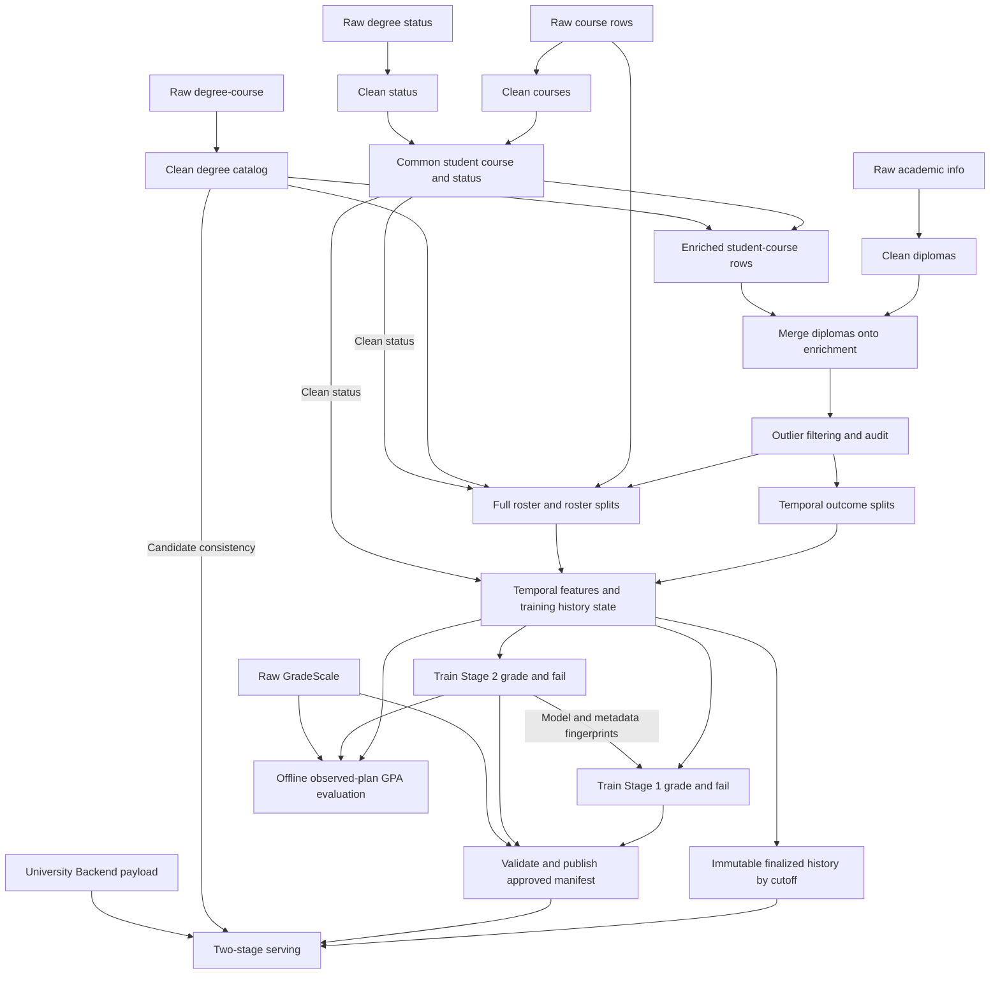

# Phase 1 — Project build audit

Date: 2026-11-17. Repository: Academic Advisor Stable, branch `data_cleaning`, `HEAD d9c4019` plus the existing working tree changes from recommendation removal and stabilization.

## A. Executive summary

**Audit complete. Production build readiness is BLOCKED.** The current source can be used to prepare an isolated build. All five required raw Parquets are present. Cleaned data, roster, temporal splits, and feature exports are readable and passed structural checks. Both feature exports can produce the ordered 31- and 43-feature matrices, but they contain retired columns and lack current build provenance. Revalidate them against a fresh isolated build before using them as release evidence.

The approved model files, category levels, and serving manifest are absent. The two frozen history bundles pass stored hash checks but fail the current serving contract because they still carry `attempt_sum`. An initialization probe with default settings reported catalog and GradeScale ready, and model, history, and recommendation readiness false. The last stabilization run verified the entire recommendation flow with synthetic input. A real University Backend request has not been verified.

This audit used source and CLI inspection, Parquet metadata and selected-data checks, in-memory matrix validation, local asset and API readiness probes, `pip check`, and pytest collection. It did not execute any build, training, publication, or live Backend operation. The build order in section H is for a subsequent approved phase.

## B. Component status

**READY** means usable for the stated purpose. **NEEDS BUILD** means a usable required output is missing. **NEEDS VALIDATION** means an artifact or path exists with limits on the evidence available. **BLOCKED** means a dependency prevents execution or release. **NOT REQUIRED** means the component is outside the production build.

| Component | Source Code | Inputs | Outputs | Compatibility | Tests | Status |
|---|---|---|---|---|---|---|
| Raw ingestion | [paths.py](../../src/paths.py), Parquet readers in `src/data/cleaning/` | Four institutional exports and GradeScale listed below | Readable Parquets already supplied | Schemas readable. Compare export lineage and finalization attestations before release | Cleaning and GradeScale tests | **READY** for build input |
| Catalog | `src/data/cleaning/clean_degree_course.py`, `src/api/catalog.py` | Degree-course export | `data/clean/degree_course.parquet`, 4,006 rows | Loaded 58 degrees, with unique degree/course keys. Current API loader accepts it | `test_clean_degree_course.py`, `test_runtime_catalog.py` | **READY** as API validation catalog |
| Student course and status cleaning | `src/data/cleaning/clean_student_course.py`, `clean_student_status.py` | Raw courses and degree status | Pre-common course/status, 459,620 / 108,974 rows | Readable and consumed by the common filter. Build lineage needs replay | `test_clean_student_course.py`, `test_clean_student_status.py`, `test_clean_utils.py` | **NEEDS VALIDATION** |
| Common student population | `src/data/building/filter_common_students.py` | Pre-common course and status | `student_course.parquet` and `student_status.parquet`, 456,595 / 107,939 rows | Downstream input files present. Recheck student/degree and history boundaries | `test_filter_common_students.py` | **NEEDS VALIDATION** |
| Student-course enrichment, diploma, outliers | `src/data/building/build_student_course_enriched.py`, `src/data/cleaning/{clean_student_diploma,clean_outliers}.py` | Clean course/status/catalog, raw academic info | 456,453 enriched rows, 32,524 diploma rows, 456,453 merged rows, 424,435 eligible outcome rows and 1,031 audited exclusions | Existing files are readable. Validate join cardinality, nulls, and exclusions on the new build | `test_build_student_course_enriched.py`, `test_clean_student_diploma.py`, `test_clean_outliers.py` | **NEEDS VALIDATION** |
| Registration roster | `src/data/building/build_registration_roster.py` | Raw course rows, clean status/catalog, audited exclusions | Full roster 474,264 rows and train/test rosters 389,062 / 74,827 | Unique student/degree/part/course keys in both splits. Zero matching outcome keys missing from the rosters | `test_build_registration_roster.py` | **NEEDS VALIDATION** for reproducibility |
| Temporal outcome split | `src/data/building/build_temporal_split.py` | Outlier-filtered outcomes | Train 356,882 rows for 20201–20243, test 67,548 for 20251–20252 | Part ranges and counts checked. Current training cutoff is 20243 | `test_build_temporal_split.py` | **NEEDS VALIDATION** for reproducibility |
| Temporal feature generation | `src/features/{build_temporal_features,temporal_features}.py` | Both outcome splits, both roster splits, clean student status | Two 95-column feature exports, plus training `data/artifacts/course_history_state.pkl` | Required values can be projected. Exports and pickle contain retired fields. Fresh values and provenance need comparison | `test_temporal_features.py`, `test_feature_contract_responsibilities.py`, `test_two_stage_matrix.py` | Exports **NEEDS VALIDATION**. Training state **NEEDS BUILD** in fresh output |
| Ordered feature contract | `src/features/feature_contract.py`, `src/modeling/shortlist_features.py`, `src/recommendation/two_stage_artifacts.py` | Canonical names and 12 plan-context columns | 31 Stage 1 and 43 Stage 2 model inputs | Both full Parquets projected successfully in contract order. Approved headers unavailable | `test_two_stage_matrix.py`, `test_two_stage_artifacts.py` | **READY** for matrix formation |
| Frozen base history | `src/features/{build_frozen_history,frozen_history}.py`, `src/recommendation/history_update.py` | Contract-compatible feature rows through an explicitly finalized cutoff | Existing `as_of_20243` and `as_of_20251` snapshots | File hashes match, but both sums include retired `attempt_sum`. Both rejected by serving | `test_frozen_history.py`, `test_history_update.py` | **NEEDS BUILD** |
| Specialty history | Optional injected type in `src/features/frozen_history.py` | Explicit specialty implementation and valid source, when used | No specialty bundle in the two present snapshots | Base production contract does not use specialty columns. Incremental serving compatibility rejects models declaring specialty/degree-history dependencies | Frozen history and artifact tests | **NOT REQUIRED** |
| GradeScale | `src/grade_scale.py` | `data/raw/v_acs_grade.parquet`, 72 rows | Loaded reference table | Startup accepts it and both observed feature-table grade versions resolve. Future manifest must pin these bytes | `test_grade_scale.py` | **READY** |
| Stage 2 training | `src/modeling/{train_models,training_config}.py` | Validated train/test feature exports | Grade model, fail model, metadata, category levels | Current four outputs absent | `test_train_models.py`, `test_training_config.py`, `test_fresh_artifact_metadata.py` | **NEEDS BUILD** |
| Stage 1 training | `src/modeling/train_shortlist_models.py` | Same feature exports, Stage 2 outputs, current source fingerprints | Training model pair, categories, metadata and holdout evidence | Outputs absent. Requires exact Stage 2 provenance | `test_two_stage_matrix.py`, `test_two_stage_artifacts.py` | **BLOCKED** by Stage 2. Then build |
| Publication and model activation | `src/modeling/build_artifact_manifest.py`, `src/recommendation/{two_stage_artifacts,ranking_policy}.py` | Both model pairs, metadata/categories, verified sources, GradeScale, explicit approval for serving | Published Stage 1 pair/categories and joint manifest | None present. Synthetic publication and activation were exercised in stabilization | `test_two_stage_artifacts.py`, `test_two_stage_activation.py`, `test_migration_ranking_provenance.py` | **BLOCKED** by assets and approval |
| Offline and observed-plan evaluation | `src/evaluation/{evaluate_plan_gpa,local_course_inputs,observed_plan}.py`, Streamlit views | Stage 2 grade model/categories, test features, GradeScale. Optional UI comparisons use cleaned roster/history/status/catalog | Existing evaluation reports, 67,548 course rows and 12,715 plan rows | Historical metrics carry legacy version fields and originating model is missing. Refresh after training | `test_evaluate_plan_gpa.py`, `test_observed_plan.py`, `test_stable_ui_views.py` | **BLOCKED** for a current rerun |
| Candidate and plan generation, scoring and ranking | `src/recommendation/{inputs,constraints,plan_generation,plan_scoring,shortlist,ranking,two_stage_engine}.py` | Backend candidates, constraints, ready history and approved model assets | Ranked plan response | Synthetic end-to-end verification passed. Local catalog validates the supplied candidates | Payload, constraints, shortlist, ranking and engine tests | **BLOCKED** for real serving |
| API and request validation | `src/api/{app,service,schemas,settings}.py`, adapters and validators | Provider payloads, request policy, keys and runtime assets | Validation diagnostics, combined/split recommendations and health | Code and synthetic HTTP tests available. Catalog and GradeScale load. Real Backend contract unverified | `test_api_stable.py`, `test_api_portable_settings.py`, `test_candidate_input_contract.py` | **BLOCKED** for full inference |
| Incremental history | `src/recommendation/cumulative_history.py`, API history administration | Valid baseline, approval and finalized aggregate deltas | Optional control pointer and immutable activated snapshots | Default control file absent. Base frozen serving can operate independently. Initialization requires valid attested 20251 prefix | `test_cumulative_history.py`, `test_history_update.py` | **BLOCKED** if enabled |
| RequestStore | `src/api/request_store.py`, `ApiService` | Writable private runtime path and request ownership | Lazy SQLite state | Default file absent as expected. Check ACLs and retention for intended split intake | `test_api_request_store.py`, split-intake cases in `test_api_stable.py` | **NEEDS VALIDATION** at deployment |
| Environment and documentation | `pyproject.toml`, `requirements.lock`, `.env.example`, `README.md`, `docs/` | Python 3.11+, locked libraries and environment settings | Installed local venv, API and UI entry points, documented interfaces | Python 3.11.5, no broken requirements. Existing deployment settings were not read. README/logic map still contain 33/47 descriptions | `test_api_portable_settings.py`, `test_streamlit_stable.py` | **NEEDS VALIDATION** for the new environment |
| Tests and release helpers | `tests/{unit,integration}/`, `tools/{verify_standalone,prepare_release,verify_release}.py` | Local fixtures, reviewed source and package assets when applicable | Collected suite and future delivery archives | 963 cases collected. Five known failures. Package helpers have independent compatibility blockers | See I and J | **NEEDS VALIDATION** for suite. **BLOCKED** for release packaging |
| Removed local recommendation and unused raw requests | No production local input adapter. Optional evaluation adapter is separate | `data/raw/v_crg_std_cor_temp_request.parquet` (556,700 rows) | None in the current serving path | No dependency from engine or API to these local requests | `test_two_stage_payloads.py`, `test_main_runner.py` | **NOT REQUIRED** |

Required raw files under `data/raw/`: `v_crg_student_course_raw.parquet` (1,017,491 rows), `v_add_student_degree_status.parquet` (189,158), `v_acd_degree_course.parquet` (4,006), `v_add_academic_info.parquet` (32,548), and `v_acs_grade.parquet` (72).

## C. Data dependency graph



Feature export rows match the source split identities, parts, marks and order. Label checks found zero differences between `is_fail` and `final_mark < 50`. The test rows are 34,414 for 20251 and 33,134 for 20252. Existing feature export column order differs from the model view. Matrix preparation selects by name and returns the exact contract order. The measured full ordered shapes were 356,882 × 31 / 43 for train and 67,548 × 31 / 43 for test.

## D. Model readiness

| Artifact set | Canonical files | Audit result |
|---|---|---|
| Stage 2 training and serving | `models/{grade_regressor.txt,fail_risk_classifier.txt,model_metadata.json}` and `data/artifacts/category_levels.json` | All absent |
| Stage 1 original training | `models/shortlist_training/{grade_regressor.txt,fail_risk_classifier.txt,category_levels.json,model_metadata.json}` | All absent |
| Stage 1 training evidence | `data/evaluation/shortlist/{grade_validation.json,fail_validation.json,holdout_predictions.parquet,model_comparison.json}` | All absent |
| Published Stage 1 and manifest | `models/shortlist/{grade_model.txt,fail_model.txt,category_levels.json,manifest.json}` | All absent. Direct loader stops at the missing manifest |
| GradeScale | `data/raw/v_acs_grade.parquet` | Readable, with compatible observed grade versions. Hash will be checked against the new manifest |
| Packaging-only build record | `data/artifacts/build_manifest.json` | Absent. Separate from the serving manifest, with no current canonical producer found |

Stage 2 uses 39 numeric and 4 categorical inputs. Stage 1 excludes the 12 plan-context features and uses 31 inputs. The contract and matrices are verified against current source. No production model headers or saved category sets are available for direct comparison. Publication checks ordered features, exact model/category bytes, categorical header and levels, objectives, training cutoff and source evidence. Grade target is `final_mark` and binary fail is `final_mark < 50`. Stage 1 records hashes of both feature files, all four Stage 2 outputs, and five source files. Preserve those inputs once training starts. The established training policy uses 2023/2024 temporal validation and a 2025 holdout. Extending the dates requires a separate review.

The trained Stage 1 and Stage 2 files must come from one verified build. The manifest publication gate preserves approval and performs no training. Production uses approved Pareto v1 for both stages with the current Balance policy. The existence of models or a manifest alone does not establish production activation. No trained weights or policies were modified in this audit.

## E. Recommendation engine readiness

1. The University Backend submits `student_api_response` and `courses_api_response`, identity, source context, timing, credit limits and registration policy. FastAPI authenticates and validates the combined body. Split intake pairs the two submissions through the same recommendation service.
2. The adapters verify student and degree scope, derive student history features from supplied history, and validate `availableCourses` with provider eligibility, attempts and group policy. The startup-loaded catalog checks supplied courses and properties. Candidate attempts derive from the provider's `ATTEMPTS_COUNT`.
3. The service constructs the requested credit and academic policies. `TwoStagePlanRecommender.recommend_from_payloads()` uses `prepare_recommendation_payloads()` to produce `PreparedRecommendationInputs`, validates the model cutoff, captures eligible serving history, and prepares candidate rows.
4. Stage 1 predicts marks and fail risk on 31 features. Feasible plans obey exact credit totals and request constraints. The shortlist contains up to 50 plans.
5. Stage 2 computes plan and peer context, scores the shortlisted plans on 43 features, aggregates grade and risk, ranks within the shortlist, and sends the API JSON with allowlisted metadata. The result does not guarantee global Top-K optimality.

A source scan confirmed the local file adapter, candidate file reader and local snapshot builder are absent from production recommendation. Local registration and outcomes remain optional sources for the observed-plan evaluation UI. The previous synthetic HTTP probe returned three ranked plans from Backend-supplied candidates, rejected catalog conflicts before scoring and made zero Parquet reads during the request. Section I separates this evidence from production readiness.

## F. Runtime dependencies

| Resource | Startup | Request time and deployment notes |
|---|---|---|
| Python environment | Install `requirements.lock` and the local `.[api,ui,dev]` package | FastAPI, Uvicorn and Pydantic for serving, LightGBM and data libraries for inference. Streamlit is optional |
| Service settings and keys | `ApiSettings.from_env()`. Use `.env.example` as a template and provision independent service, admin and finalization keys. Existing `.env.local` was not opened | Authentication per protected route. Set absolute private runtime paths or use project-relative defaults. Test owner isolation, retention and authorized history modes |
| Catalog | `data/clean/degree_course.parquet`, loaded by `load_catalog()` | Checks Backend courses on the loaded index. It does not create candidate records |
| GradeScale | `data/raw/v_acs_grade.parquet` loaded independently and by the manifest-pinned loader | In-memory conversion and grade-version checks |
| Both stage model pairs, metadata, categories and approved manifest | Canonical paths in section D. Loaded and verified by `load_two_stage_artifacts()` and activation checks | In-memory inference. Request semester must be later than both model training cutoffs |
| Frozen base | `data/artifacts/history/as_of_*/{metadata.json,course_history_state.pkl}`. Fallback loader chooses latest valid base on startup | Exact requested cutoffs can load lazily. Normal mode requires the immediately previous academic part. For target 20251 the cutoff is 20243, and for target 20252 it is 20251. Authorized backtesting may select older history |
| Incremental state | Configurable `ADVISOR_HISTORY_INCREMENTAL_ROOT` defaults to `data/artifacts/history_incremental`. Control file absent at default | Active pointer and bundles are read during readiness/request refresh when configured. Enable only after attested baseline, delta lineage, activation and rollback validation. Baseline source path and active writable root must be separate |
| SQLite RequestStore | Configurable `ADVISOR_REQUEST_STORE_PATH`, default `.api-state/requests.sqlite3`. Absent at default | Lazily used for split intake and request-status lookup. Combined route does not open it. Plan service-account ACLs, retention, locks and restart tests |
| Provider integration | No representative real request available. Actual serving routes accept submitted Backend payloads | Supply approved provider fields and confirmed temporal semantics. Optional upstream fetch controls in settings are not used by the recommendation handler. Streamlit has a separate client |
| Optional observed-plan UI | Streamlit config and same API server | Local registration/outcome comparison uses roster, course history, student status, catalog and saved evaluation files or independently supplied observed data |

A health HTTP success indicates that the process is responding. Check `recommendation_readiness.ready` explicitly. Fresh usable artifacts are needed before testing actual scoring. Production capacity limits are still unresolved.

## G. Missing, stale or incompatible components

- **Models and manifest:** all expected files in section D are missing. No loader fallback can produce real predictions. The checkout requires a compatible approved bundle or a later authorized training and publication phase.
- **History:** hashes match both stored frozen files, and the listed source feature hashes match the current Parquets. Both deserialize with extra global sum `attempt_sum` and fail `validate_history_state()` with `Invalid official CourseHistoryState contract/configuration.` The separate training history state also retains that retired sum. Use an isolated build for replacement. Editing serialized keys or hashes would lose provenance.
- **Feature data:** both exports still contain `plan_course_type_id`, `course_history_avg_attempt`, `plan_credit_weighted_avg_attempt` and `peer_credit_weighted_avg_attempt`. Current ordered matrices exclude these fields. This establishes structural compatibility only. Build fresh features in isolation and compare the supported columns. Preserve the old exports for that comparison.
- **Evaluation evidence:** saved reports predate this build contract and their originating model is missing. Preserve them as historical evaluation and write new reports in the isolated root.
- **Packaging:** the archive writer requires absent `data/artifacts/build_manifest.json` and reviewed Git-index contents. Both release helpers still call the current history loader with the removed `dataset_version="V2"` argument. There is no current producer for that build record. Review these separately before packaging. They do not block the basic API loader. The existing worktree has reviewed-phase edits and untracked source. A clean release cannot be inferred from `HEAD` alone.
- **Integration and documentation:** no representative University payload, finalized current-term history or production load envelope was established. Some documentation still describes 33/47 inputs. Use the actual 31/43 contract and current cutoff rules.

## H. Ordered build plan for the next phase

**Precondition:** approve a build and choose a new, empty, versioned project root. Curate a reviewed snapshot of the current Stable source, including the new evaluation adapter and stabilization fixes, rather than relying on Git-tracked files alone. Copy `src/`, `tools/`, `tests/`, build configuration, `docs/api_contract.md`, `.env.example`, and the five required raw exports. Keep a private SHA-256 inventory of the source snapshot, raw copies and build outputs. Compare raw hashes before and after the build. Provision dedicated environment keys and state paths in the new root. Keep existing datasets, environments, SQLite databases, trained outputs and frozen history outside this new tree.

Run the following commands **only in the new root after approval**. The module and step names were verified through `src.main --list` and `--all --dry-run`. History, manifest and server flags were verified through installed CLI help. None of the writes below ran during the audit.

```powershell
py -3.11 -m venv .venv
$py = (Resolve-Path .venv/Scripts/python.exe).Path
& $py -m pip install -r requirements.lock
& $py -m pip install -e ".[api,ui,dev]"
& $py -m pip check
& $py -c "from pathlib import Path; from src.paths import PROJECT_ROOT; assert PROJECT_ROOT == Path.cwd().resolve(), PROJECT_ROOT"
& $py -m src.main --list
& $py -m src.main --all --dry-run
```

| Order and operation | Inputs or dependencies | Command from the isolated root | Expected output and validation | Write / overwrite behavior |
|---|---|---|---|---|
| 1. Degree catalog | Raw degree-course export | `& $py -m src.main --step clean_degree_course` | `data/clean/degree_course.parquet`. Gate D1 plus API catalog load | Overwrites canonical Parquet. Safe in empty root |
| 2. Student courses | Raw course export | `& $py -m src.main --step clean_student_course` | `data/clean/student_course_pre_common.parquet`. Gate D1 | Overwrites canonical Parquet |
| 3. Degree status | Raw student degree status | `& $py -m src.main --step clean_student_status` | `data/clean/student_status_pre_common.parquet`. Gate D1 | Overwrites canonical Parquet |
| 4. Common filter | Steps 2–3 | `& $py -m src.main --step filter_common_students` | Clean `student_course.parquet` and `student_status.parquet`. Gate D1 and key/coverage checks | Overwrites both canonical outputs |
| 5. Course enrichment | Steps 1 and 4 | `& $py -m src.main --step build_student_course_enriched` | `data/clean/student_course_enriched.parquet`. Gate D2 and join-cardinality checks | Overwrites canonical Parquet |
| 6. Diplomas | Academic info export and step 5 | `& $py -m src.main --step clean_student_diploma` | `data/clean/student_diploma.parquet` and `data/merged/student_course_enriched_with_diploma.parquet`. Gate D2 and retained-row checks | Overwrites both outputs |
| 7. Outliers | Step 6 merged outcomes | `& $py -m src.main --step clean_outliers` | `data/merged/student_course_enriched_without_outliers.parquet` and `outlier_students.parquet`. Gate D2 and audit reconciliation | Overwrites output and audit |
| 8. Outcome splits | Step 7 filtered outcomes | `& $py -m src.main --step build_temporal_split` | `data/temporal/temporal_train.parquet` and `temporal_test.parquet`. Gate D2 and part ranges | Overwrites both splits |
| 9. Registration roster | Raw course export, steps 1 and 4, step 7 audit | `& $py -m src.main --step build_registration_roster` | `data/clean/registration_roster.parquet` and `data/temporal/temporal_{train,test}_roster.parquet`. Gate D2 and outcome-to-roster membership | Overwrites three outputs |
| 10. Temporal features | Steps 8–9 and clean student status | `& $py -m src.main --step build_temporal_features` | `data/features/temporal_{train,test}_features.parquet` and `data/artifacts/course_history_state.pkl`. Gate F, ordered matrix and baseline comparison | Overwrites both Parquets and training pickle |
| 11. Frozen prefixes | Step 10 plus explicit finalized source attestation | See history commands below | Canonical `data/artifacts/history/as_of_<part>/` bundles. Gate H and explicit serving validation of each cutoff | Refuses an existing cutoff. If partial, retain it and restart in another new build root |
| 12. Stage 2 | Step 10 and approved training scope | `& $py -m src.main --step train_models` | Stage 2 outputs in section D. Gate M1 | Overwrites model, metadata and category outputs |
| 13. Stage 1 | Step 12, step 10 and current source hashes | `& $py -m src.main --step train_shortlist_models` | Stage 1 original artifacts and evaluation evidence in section D. Gates M1 and M2 | Refuses existing training metadata. Partial or evidence outputs can still be overwritten |
| 14. Manifest publication | Steps 12–13, GradeScale and valid approval record | See publication command below | `models/shortlist/` verified serving bundle. Gate M2, then loader and readiness checks | Stages and validates before publication. Refuses an existing destination. Does not overwrite source models |
| 15. Offline evaluation | Stage 2 grade model/categories, step 10 test table, GradeScale | `& $py -m src.main --step evaluate_plan_gpa` | Three `data/evaluation/plan_gpa_*` reports. Gate E and evidence comparison. Can run after step 12 independently of publication | Overwrites existing evaluation files |
| 16. Serving and system tests | Catalog, GradeScale, valid history, approved manifest, environment configuration | See commands below | Green readiness and synthetic HTTP end-to-end, then approved representative Backend test. Gate R then full suite | Readiness probe reads assets. Split-intake and history administration can write state, so use isolated private paths |

Steps 8 and 9 branch from the same cohort preparation. The CLI order runs the split first. Freeze history before serving. Its build is independent of training after step 10. The verified standard `--all` excludes freezing and publication and is unsuitable as the single command for a complete runnable build.

For the documented 2025 validation periods, issue these commands only after confirming the source outcomes are finalized through each cutoff. The default source for 20243 is train features. The default for 20251 is train plus test features filtered through the cutoff. Source prefix checks found 356,882 and 391,296 mechanically eligible rows, respectively. That is data evidence, not a finalization attestation.

```powershell
& $py -m src.features.build_frozen_history --as-of-part 20243 --finalized-through-part 20243
& $py -m src.features.build_frozen_history --as-of-part 20251 --finalized-through-part 20251
& $py -c "from src.features.frozen_history import load_frozen_history; from src.recommendation.history_update import validate_history_state; [validate_history_state(load_frozen_history(p)[0]) for p in (20243, 20251)]"
```

`--sources` accepts explicit schema-compatible exports, and `--history-root` writes to a distinct history root for inspection. Standard API fallback expects canonical base history under the new project root. Newer targets need their own verified immediately preceding cutoff. Existing test data through 20252 does not by itself authorize serving or an extension of the current model training contract.

Set `$approvalReference` and `$approvalDate` to the actual authorized ranking policy reference and its ISO date before publication. Leave serving activation pending until the authorization has been recorded.

```powershell
if (-not $approvalReference -or -not $approvalDate) { throw 'Provide the reviewed approval reference and ISO date first.' }
& $py -m src.modeling.build_artifact_manifest --approval-reference $approvalReference --approval-date $approvalDate
& $py -c "from src.recommendation.two_stage_artifacts import load_two_stage_artifacts; load_two_stage_artifacts()"
& $py -c "from src.api.service import ApiService; from src.api.settings import ApiSettings; a=ApiService(settings=ApiSettings()); a.initialize(); assert a.health()['recommendation_readiness']['ready']"
```

In the new root, create a dedicated `.env.local` using the example and deployment-specific settings. Then run the loopback service and the optional UI in separate terminals. The CLI accepts these flags. Confirm HTTP health and the readiness field before sending a recommendation. Treat incremental history setup as a separate authorized operation if required.

```powershell
& $py -m uvicorn src.api.app:create_app --factory --env-file .env.local --host 127.0.0.1 --port 8000
& $py -m streamlit run tools/academic_advisor_streamlit/streamlit_app.py --server.address 127.0.0.1 --server.port 8501 --browser.gatherUsageStats false
```

Use `tools/verify_standalone.py --help` for the optional future cleanroom verifier. Its real run builds, trains and deletes its temporary tree in cleanup. Use the persistent versioned root for artifacts intended for review and delivery. Packaging is independently blocked as noted in G. `python -m tools.verify_release --help` works in the existing environment, but that does not validate its package workflow.

## I. Testing plan

Collection completed with **963 tests**. The last executed full stabilization suite recorded **956 passed, 5 failed, 2 skipped**. The engine (72), API (11) and Streamlit (3) groups passed with synthetic fixtures. The two skips were the Windows service-account ACL case and pinned real-model activation. This audit did not rerun the full suite. Use the tests below in the isolated root, plus the artifact checks in H. Stop each gate on unexplained failures.

| Gate | Command | Asset or behavior check |
|---|---|---|
| CLI preflight | `& $py -m pytest tests/unit/test_main_runner.py -q` | Check stage selection, dry run and rejection of the obsolete recommendation section |
| D1. Clean input and schema | `& $py -m pytest tests/unit/test_clean_utils.py tests/unit/test_clean_degree_course.py tests/unit/test_clean_student_course.py tests/unit/test_clean_student_status.py tests/unit/test_filter_common_students.py tests/unit/test_runtime_catalog.py -q` | Compare source hashes, null and key counts, student/degree scope and catalog consistency |
| D2. Enrichment, roster and split | `& $py -m pytest tests/unit/test_build_student_course_enriched.py tests/unit/test_clean_student_diploma.py tests/unit/test_clean_outliers.py tests/unit/test_build_temporal_split.py tests/unit/test_build_registration_roster.py -q` | Verify join cardinalities, outlier exclusions, no train/test overlap, no duplicated roster keys and membership of every outcome in its split roster |
| F. Features | `& $py -m pytest tests/unit/test_temporal_features.py tests/unit/test_feature_contract_responsibilities.py tests/unit/test_two_stage_matrix.py -q` | Assert matrix order/dimensions, feature values against the baseline, valid grade versions and zero label mismatches. Audit temporal feature generation for target leakage |
| H. History | `& $py -m pytest tests/unit/test_frozen_history.py tests/unit/test_history_update.py tests/unit/test_cumulative_history.py -q` | Verify source/file hashes, lineage, exact eligible cutoff and shape. Exercise invalid/future cutoff and incremental activation using synthetic state |
| M1. Model training | `& $py -m pytest tests/unit/test_training_config.py tests/unit/test_train_models.py tests/unit/test_fresh_artifact_metadata.py -q` | Check resolved weight/label/validation policies and actual trained headers and metadata. Archive holdout metrics and source hashes before publication |
| M2. Publication/activation | `& $py -m pytest tests/unit/test_two_stage_artifacts.py tests/unit/test_two_stage_activation.py tests/unit/test_migration_ranking_provenance.py -q -rs` | Require the pinned real-model activation case to execute once files exist. A skip or unapproved manifest does not satisfy the serving gate |
| E. Evaluation | `& $py -m pytest tests/unit/test_evaluate_plan_gpa.py tests/unit/test_observed_plan.py tests/unit/test_stable_ui_views.py -q` | Verify new output provenance, observed-plan join coverage and targets, and separation of actual outcomes from recommendation inputs |
| R. Runtime | `& $py -m pytest tests/unit/test_candidate_input_contract.py tests/unit/test_two_stage_payloads.py tests/unit/test_two_stage_constraints.py tests/unit/test_two_stage_shortlist.py tests/unit/test_ranking_strategies.py tests/unit/test_two_stage_engine.py tests/unit/test_grade_scale.py tests/unit/test_api_portable_settings.py tests/unit/test_api_request_store.py tests/integration -q -rs` | Validate request handling, identity, scoring and ranking. Exercise a synthetic request against real built assets, then an approved de-identified University payload with verified timings |
| Whole build | `& $py -m pytest tests -q -p no:cacheprovider -rs` | Keep an exact run summary. Review known failures before using the suite as a promotion gate |

Previously failing cases to resolve or formally disposition before promotion:

| Gate | Test | Evidence and next check |
|---|---|---|
| H | `test_cumulative_history.py::test_approved_initialization_preserves_full_weighted_history_and_source` | Source and reserialized bytes have equal hashes. Verify distinct provenance fields and check whether the inequality assertion still reflects policy |
| H | `test_frozen_history.py::test_cli_accepts_custom_source_by_contract_without_filename_label` for both `finalized_outcomes.parquet` and `export.parquet` | Fixture always writes/passes `outcomes.parquet`. Check fixture path selection before interpreting the metadata mismatch |
| H | `test_history_update.py::test_latest_valid_load_skips_incomplete_corrupt_and_wrong_version` | The 20261 fixture rewrites metadata without changing values. Check whether the fixture should introduce a real contract defect rather than expecting a valid cutoff to be skipped |
| Whole build / Windows cleanroom | `test_standalone_timeout.py::test_timeout_stops_owned_descendants_before_temporary_cleanup` | Child survived after timeout in full and isolated runs. Validate process-tree termination on the intended worker before using the automatic cleanup harness |

The main runner rejection and dry-run tests already passed in stabilization and belong at the CLI preflight. Future evidence gaps include a repeatable data-lineage comparison from the current export, a persistent HTTP regression for catalog-only course exclusion and blocked per-request candidate file reads, real provider input tests and worker-level Windows ACL/timeout verification. Existing synthetic tests do not substitute for those checks.

## J. Risks and stop conditions

- **Overwrite risk:** `src.paths.PROJECT_ROOT` follows the source module, so changing the working directory alone does not redirect outputs. Verify both the source and data root before any write. Fail fast on nonempty output locations and preserve any partial run separately.
- **Provenance risk:** changing training features, source, category maps, GradeScale, model bytes or ranking metadata after publication invalidates evidence. Verify hashes and compare a new evaluation before changing any serving root. Keep training inputs, private logs and archival evidence access-controlled.
- **History risk:** a valid base requires the current aggregate contract and explicit finalization evidence for its cutoff. Never overwrite existing frozen versions or edit their hashes to force activation. Treat incremental activation and rollback as separate administrative operations. For historical requests, reject target/future history and enforce the requested cutoff.
- **Data governance:** copy only approved raw files into the private build workspace. Keep real provider payloads, secrets, training outputs and SQLite state out of the source export and Git. Reuse GradeScale and verified raw bytes as inputs. Validate current cleaned and feature outputs rather than promoting them by existence.
- **Academic semantics:** check degree and semester boundaries, missing diploma values, and the effect of whole-student outlier exclusions in the isolated build. Keep the existing training attempt calculation distinct from the University Backend's eligibility and attempt rules. Any policy changes belong in a separate academic review.
- **Environment and packaging:** earlier Windows cleanup failure makes the transient cleanroom verifier unsuitable as the first persistent build. Packaging has the independent blockers in G. Check tool compatibility and reviewed source before any archive creation.
- **Working tree:** the initial whitespace check reported pre-existing trailing spaces in `src/recommendation/inputs.py:109`. Preserve unrelated edits. Existing nonempty histories and evaluation results are evidence to retain.
- **Release gate:** require current asset readiness, exact approved policy, an exercised pinned model activation test, accepted regression outcomes, and an approved representative University Backend payload scored through the real stack before deployment.

Only this audit report was added in Phase 1.
